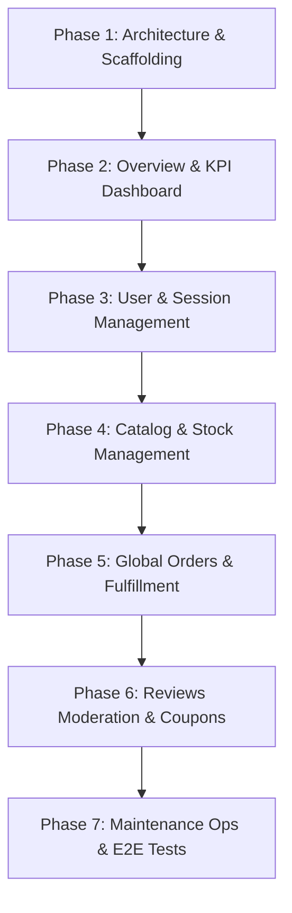

# M17 — Admin Dashboard & Operations Console Plan

> **Executive Summary:**  
> With M16 having established a production-grade, zero-trust RBAC perimeter and caller-scoped access control across all 12 backend microservices, **M17 delivers the dedicated Back-Office Operations Web Application (`admin/`)**.  
> The dashboard empowers store administrators, warehouse operators, and customer support staff to execute daily business workflows—user role management, catalog authoring, stock replenishment, order fulfillment, refund processing, review moderation, promotional coupons, and search/recommendation maintenance—through an intuitive, high-performance interface.

---

## 1. Context & Objectives

- **Milestone:** M17 — Admin Dashboard (R4 Operations & Hardening)
- **Parent Plan:** `docs/PROJECT_PLAN.md` (§8, R4 M17)
- **Prerequisite:** M16 Authorization & RBAC Matrix (`docs/M16_AUTHORIZATION_RBAC_PLAN.md`)
- **Target Audience:** Store Administrators (`ADMIN`), Fulfillment & Support Staff (`STAFF`). Non-staff (`CUSTOMER` or unauthenticated) are blocked at the gate.

### Architectural Invariants
1. **Zero Direct DB Access:** The admin application speaks *only* to the API Gateway at `http://localhost:3000/api/v1`. Downstream microservices remain isolated within the private Docker network.
2. **Session & Cookie Perimeter:** Uses the Gateway's secure HTTP-only cookies (`commerce_session` / `refresh_token`), carrying correlation ID and W3C `traceparent` headers on every administrative request.
3. **Strict RBAC Enforcement:** UI features adapt dynamically to the caller's role (`ADMIN` vs `STAFF`). Sensitive actions (role modification, account banning, search re-indexing, coupon deletion) are visible and executable only by `ADMIN`.
4. **Port Allocation:** Runs on port **`3200`** (`http://localhost:3200`), cleanly coexisting with the API Gateway (`3000`) and customer Storefront (`3100`).

---

## 2. Technology Stack & Design System

- **Framework:** Next.js 16 (App Router), React 19, TypeScript 5.
- **Styling Architecture:** Pure Vanilla CSS Design System (`admin/app/globals.css`) with CSS custom properties:
  - **Aesthetics:** Executive dark/slate theme with vibrant emerald/teal accents, glassmorphic card surfaces, responsive data tables, status pill badges, and accessible focus states.
  - **Micro-Animations:** Smooth drawer transitions, modal backdrops, and button hover states.
- **Testing:** Playwright E2E suite (`admin/e2e/admin.spec.ts`) validating end-to-end admin login, RBAC gatekeeping, and fulfillment actions.

---

## 3. Implementation Phases

### Phase 1: App Scaffolding, Design Tokens & Auth Gatekeeper
- Initialize `admin/` workspace with `package.json`, `tsconfig.json`, `next.config.ts`.
- Design tokens & typography in `admin/app/globals.css` (tokens for dark slate background, surfaces, line borders, status badges, buttons).
- Shared API Client (`admin/lib/api.ts`) supporting credentials, W3C traceparent, and structured error extraction.
- Auth Gatekeeper & State (`admin/lib/auth-context.tsx` & `/login` page):
  - Authenticates via `POST /auth/login`.
  - Verifies role (`role === 'ADMIN' || role === 'STAFF'`). Rejects `CUSTOMER` with clear notice.
  - Persistent session check via `GET /auth/me`.

### Phase 2: Operations Overview & Metrics Dashboard (`/`)
- KPI summary cards:
  - Total Orders & Confirmed/Pending fulfillment.
  - Active Users & Staff count.
  - Low Stock Alert count.
  - Pending Review Moderation count.
- Microservice Health Matrix: Live liveness/readiness indicators pinging `/health` across services.
- Quick navigation shortcuts into hot operational workflows.

### Phase 3: User & Access Administration (`/users`)
- Master user directory with real-time text search and filter by role (`ADMIN`, `STAFF`, `CUSTOMER`) and status (`ACTIVE`, `SUSPENDED`, `BANNED`).
- Role elevation & demotion modal:
  - Calls `PATCH /users/:id/role`.
  - UI enforcement preventing admin self-demotion.
- Account status management:
  - Calls `PATCH /users/:id/status` to suspend/activate accounts and instantly revoke active sessions.
- Session inspection & remote termination.

### Phase 4: Product Catalog & Real-Time Stock Management (`/catalog`, `/inventory`)
- Catalog table listing all products, slugs, pricing (formatted with currency), and categories.
- Product creation & edit drawer modal:
  - Calls `POST /catalog/products` and `PATCH /catalog/products/:id`.
- Category management: create & rename categories (`POST /catalog/categories`, `PATCH /catalog/categories/:id`).
- Stock replenishment console:
  - Real-time stock viewer showing available vs reserved stock.
  - Stock adjustment and replenishment actions (`POST /inventory/stock/replenish`).

### Phase 5: Global Orders, Fulfillment & Refund Operations (`/orders`)
- Global multi-tenant orders feed (`GET /orders` with Staff override).
- Filter by status (`CONFIRMED`, `SHIPPED`, `DELIVERED`, `CANCELLED`).
- Order Details Drawer:
  - Customer information, line items, frozen exchange rates, destination address, and shipping rate.
  - Fulfillment controls: Dispatch shipment (`POST /shipments/:id/dispatch`), Mark delivered (`POST /shipments/:id/deliver`).
  - Financial compensation: Trigger Stripe payment refund (`POST /payments/refund`).

### Phase 6: Review Moderation & Coupon Management (`/reviews`, `/coupons`)
- Review Moderation Queue:
  - Dedicated feed of pending customer reviews (`GET /reviews/moderation/pending`).
  - Verified-buyer indicator and rating stars.
  - One-click Approve (`POST /reviews/:id/approve`) / Reject (`POST /reviews/:id/reject`).
- Promotion & Coupon Engine:
  - Active coupons table with expiration, discount rate, and usage counts.
  - Create coupon dialog (`POST /pricing/coupons`) with code generator and rule validation.
  - Coupon deactivation/deletion (`DELETE /pricing/coupons/:code`).

### Phase 7: System Operations, Automated Testing & Runbook (`/system`)
- Maintenance Console:
  - Re-sync OpenSearch catalog index (`POST /search/admin/recreate-index`).
  - Rebuild co-purchase recommendations model (`POST /recommendations/admin/rebuild`).
- Automated E2E verification (`admin/e2e/admin.spec.ts`):
  - Admin login & auth state persistence.
  - Staff role access vs customer denial.
  - Product creation and stock replenishment flow.
  - Review moderation flow.
- Add `npm run dev:admin` and `npm run test:admin` scripts to root `package.json`.
- Secrets scan and git hygiene.

---

## 4. Definition of Done for M17

- [x] All 7 phases implemented and verified.
- [x] Admin dashboard boots cleanly on port 3200 via `npm run dev:admin`.
- [x] Works seamlessly against the running Docker microservice stack through the API Gateway.
- [x] Role enforcement strictly verified: `CUSTOMER` denied access; `STAFF` allowed operational routes; `ADMIN` allowed full control.
- [x] Automated Playwright tests pass for admin workflows.
- [x] Code formatted with Prettier and lint passes with 0 errors.
- [x] Secrets scan passes (`bash scripts/scan-secrets.sh`).
