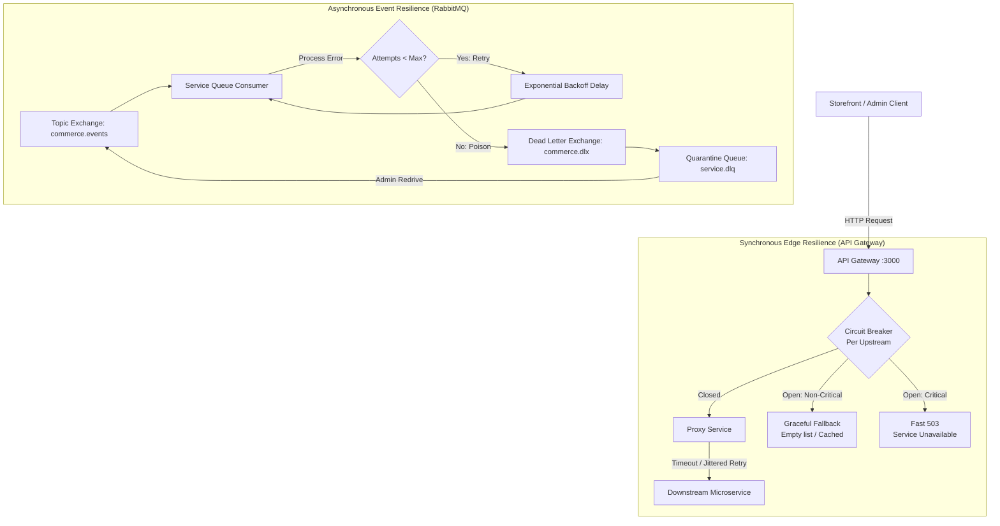
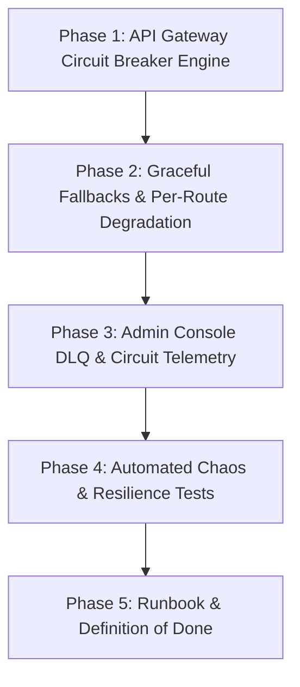

# M18 — Resilience & Fault Tolerance Plan

> **Executive Summary:**  
> In a distributed microservice mesh spanning 12 services and an event bus, partial failures are inevitable.  
> **Milestone 18 delivers production-grade resilience and fault tolerance** across both synchronous HTTP request flows and asynchronous AMQP event pipelines.  
> The system guarantees that downstream service degradation, network latency spikes, and poison messages are contained: downstream failures trigger circuit breakers that fail fast and degrade gracefully, and poison messages are automatically quarantined to Dead Letter Queues (DLQ) with exponential backoff without stalling event consumers or crashing services.

---

## 1. Context & Objectives

- **Milestone:** M18 — Resilience (R4 Operations & Hardening)
- **Parent Plan:** `docs/PROJECT_PLAN.md` (§8, R4 M18)
- **Prerequisites:**
  - M16 Authorization & RBAC Matrix (`docs/M16_AUTHORIZATION_RBAC_PLAN.md`)
  - M17 Admin Dashboard & Operations Console (`docs/M17_ADMIN_DASHBOARD_PLAN.md`)
- **Core Acceptance Criterion:** _"Killing a service degrades gracefully instead of 500-ing."_

### Architectural Invariants

1. **Fail-Fast over Connection Exhaustion:** The API Gateway must never hold client connections open indefinitely when an upstream microservice hangs or crashes. Timeouts and circuit breakers trip immediately to protect gateway thread pools.
2. **Circuit Breaker State Machine:** Per-upstream circuit breaker tracking three states: `CLOSED` (normal operation), `OPEN` (tripped after error threshold; fails fast with 503 or fallback), and `HALF_OPEN` (trialing limited requests to probe recovery).
3. **Idempotent-Only Retries with Full Jitter:** Only safe, idempotent HTTP methods (`GET`, `HEAD`) are retried. Write operations (`POST`, `PUT`, `DELETE`) fail immediately or rely on saga/outbox retries to avoid duplicate side-effects.
4. **Graceful Fallbacks for Non-Critical Projections:** Optional storefront surfaces (product recommendations, review widgets) must return degraded fallbacks (e.g. empty recommendation array `[]`) rather than propagating hard 500/503 errors to shoppers.
5. **Poison Message Isolation:** RabbitMQ consumers must never enter infinite crash loops over malformed or unprocessable messages. After reaching `maxRetries`, events are routed to `commerce.dlx` and quarantined in `${queue}.dlq` with full diagnostic headers.
6. **Administrative DLQ Redrive:** Operators can view DLQ message depths, inspect quarantined poison messages, and safely redrive/replay them once underlying issues are patched.

---

## 2. Resilience Architecture

---

## 2. Existing Baseline vs Missing Deliverables (Verified Fact Check)

Before undertaking M18, a rigorous audit of the physical repository was performed to avoid false assumptions:

| Resilience Capability                | In Parent Plan (M18) | Status in Codebase      | Source File                                                                                                                         |
| ------------------------------------ | -------------------- | ----------------------- | ----------------------------------------------------------------------------------------------------------------------------------- |
| **Gateway Timeouts**                 | Yes                  | **Already Implemented** | `apps/api-gateway/src/proxy/proxy.service.ts` (`upstreamTimeoutMs = 5000ms`)                                                        |
| **Retry with Jitter**                | Yes                  | **Already Implemented** | `apps/api-gateway/src/proxy/proxy.service.ts` (`sendWithRetry` with exponential backoff and `Math.random()`)                        |
| **DLQ with Backoff**                 | Yes                  | **Already Implemented** | `libs/rabbitmq/src/rabbitmq.service.ts` (`commerce.dlx`, `${queue}.dlq`, 3 retries, exponential backoff, poison quarantine headers) |
| **DLQ Operator Tooling**             | Yes                  | **Already Implemented** | `scripts/rabbitmq-dlq.js` (`npm run dlq:stats`, `npm run dlq:replay`, `npm run dlq:purge`)                                          |
| **Circuit Breaker**                  | Yes                  | **MISSING**             | No circuit breaker state machine (`CLOSED` / `OPEN` / `HALF_OPEN`) exists in `api-gateway`                                          |
| **Graceful Degradation / Fallbacks** | Yes                  | **MISSING**             | Gateway throws 503/504 if non-critical services (recommendations, reviews) are dead                                                 |
| **Admin UI DLQ & Breaker Console**   | Yes                  | **MISSING**             | `/system` maintenance console does not yet display DLQ status or allow one-click redrives                                           |
| **Automated Resilience Test Suite**  | Yes                  | **MISSING**             | No automated tests for circuit tripping, fallback responses, or DLQ quarantine                                                      |

---

## 3. Implementation Phases

---

### Phase 1: API Gateway Circuit Breaker Engine

- **Circuit Breaker State Machine:** Implement an in-memory, thread-safe circuit breaker (`CLOSED`, `OPEN`, `HALF_OPEN`) in `apps/api-gateway/src/resilience/circuit-breaker.ts`.
- **Configurable Parameters per Upstream:**
  - `failureThreshold`: Number of consecutive transport failures required to open the circuit (default: 5).
  - `recoveryTimeoutMs`: Time spent in `OPEN` before entering `HALF_OPEN` probe state (default: 15,000ms).
  - `halfOpenMaxTrials`: Number of consecutive successful probe requests required to close the circuit (default: 2).
- **Integration with `ProxyService`:**
  - Fast-fail when a service circuit is `OPEN` without opening a TCP socket or holding gateway worker threads.
  - Expose diagnostic headers: `X-Circuit-Breaker-Status: OPEN` and `Retry-After`.

---

### Phase 2: Graceful Fallbacks & Per-Route Degradation

- **Route Classification:**
  - **Critical Paths (Fast Fail 503):** Checkout (`/api/v1/orders`), Payments (`/api/v1/payments`), Auth (`/api/v1/auth`), Inventory (`/api/v1/inventory`). If upstream is down, fail fast with structured 503 and correlation ID.
  - **Non-Critical Paths (Graceful Fallback):**
    - Recommendations (`GET /api/v1/recommendations/products/:id`): Return HTTP 200 with `[]` and `X-Degraded: true` header when recommendations-service is unavailable.
    - Product Reviews (`GET /api/v1/reviews/products/:id`): Return empty reviews array and 0 rating count when reviews-service is down.
- **Storefront Verification:** Verify that customer product detail and catalog browsing continue seamlessly even when optional microservices are killed.

---

### Phase 3: Admin Dashboard DLQ & Circuit Breaker Telemetry

- **Admin DLQ Endpoints (`apps/api-gateway`):**
  - Expose `GET /api/v1/admin/resilience/dlq` to query RabbitMQ queue depths.
  - Expose `POST /api/v1/admin/resilience/dlq/:queue/replay` using existing `RabbitMQService.replayDeadLetters()`.
  - Expose `GET /api/v1/admin/resilience/circuits` to inspect current circuit breaker states across all 11 services.
- **Admin UI Console (`admin/app/system/page.tsx`):**
  - Add **Dead Letter Queue (DLQ) & Circuit Breaker** panel to the System Maintenance console.
  - Live indicators for circuit breaker status (`CLOSED` 🟢, `OPEN` 🔴, `HALF_OPEN` 🟡).
  - Visual poison message alerts and one-click DLQ replay button with real-time log output.

---

### Phase 4: Automated Chaos & Resilience Test Suite

- **API Gateway Resilience Tests (`apps/api-gateway/test/resilience.spec.ts`):**
  - Verify timeout cancellation aborts hanging upstream calls within 5000ms deadline.
  - Verify circuit breaker trips after 5 consecutive upstream connection failures.
  - Verify circuit breaker fails fast (< 5ms) while open without hitting the network.
  - Verify circuit transitions to `HALF_OPEN` after cooldown and recovers to `CLOSED` upon successful probe.
  - Verify fallback degradation returns `{ items: [] }` for recommendations on failure.
- **RabbitMQ DLQ Tests (`apps/orders-service/test/dlq.spec.ts` or `libs/rabbitmq/test/dlq.spec.ts`):**
  - Verify unhandled handler errors retry 3 times with exponential backoff and quarantine to `${queue}.dlq`.

---

### Phase 5: Runbook, Verification & Definition of Done

- Comprehensive runbook documenting failure modes and recovery procedures.
- Prettier formatting and whole-repo linting with 0 errors.
- Secrets scan (`bash scripts/scan-secrets.sh`).
- Git commit and synchronization with GitHub.

---

## 4. Definition of Done for M18

- [x] All 5 phases implemented and verified.
- [x] API Gateway circuit breaker protects all 11 downstream service routes (`apps/api-gateway/src/resilience/circuit-breaker.ts`).
- [x] Non-critical services (recommendations, reviews, search) degrade gracefully with HTTP 200 fallbacks (`apps/api-gateway/src/resilience/fallback.ts`).
- [x] RabbitMQ dead-letter exchange (`commerce.dlx`) and DLQ queues isolate poison messages (`libs/rabbitmq/src/rabbitmq.service.ts`).
- [x] Admin console displays real-time DLQ depths and allows redriving quarantined messages (`admin/app/system/page.tsx`).
- [x] Automated chaos and resilience tests pass with zero failures (`apps/api-gateway/test/chaos-resilience.spec.ts`).
- [x] Code formatted with Prettier and lint passes with 0 errors.
- [x] Secrets scan passes (`bash scripts/scan-secrets.sh`).
- [x] Operational runbook documented (`docs/RESILIENCE_RUNBOOK.md`).
