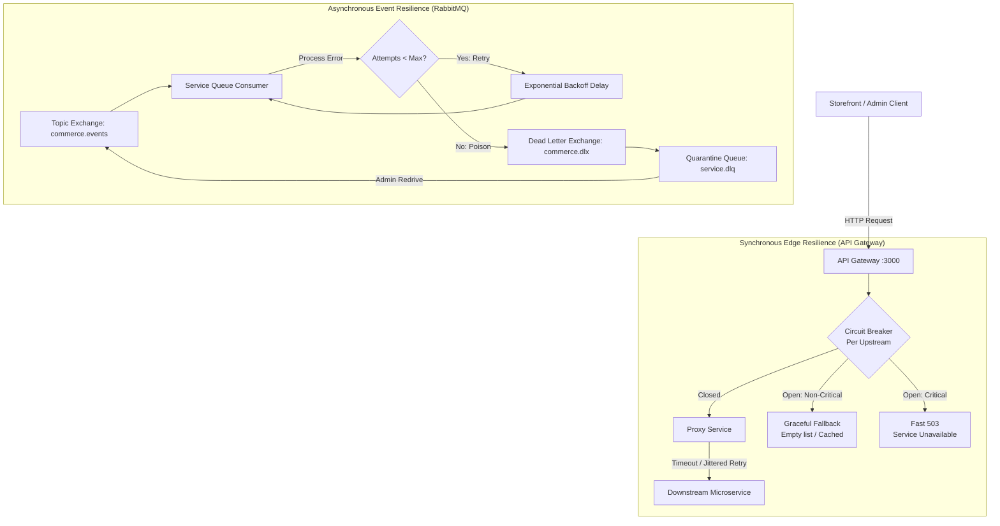
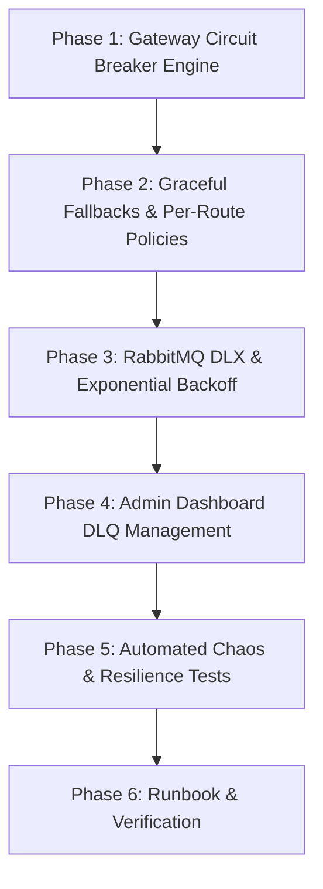

# M18 — Resilience & Fault Tolerance Plan

> **Executive Summary:**  
> In a distributed microservice mesh spanning 12 services and an event bus, partial failures are inevitable.  
> **Milestone 18 delivers production-grade resilience and fault tolerance** across both synchronous HTTP request flows and asynchronous AMQP event pipelines.  
> The system guarantees that downstream service degradation, network latency spikes, and poison messages are contained: downstream failures trigger circuit breakers that fail fast and degrade gracefully, and poison messages are automatically quarantined to Dead Letter Queues (DLQ) with exponential backoff without stalling event consumers or crashing services.

---

## 1. Context & Objectives

- **Milestone:** M18 — Resilience (R4 Operations & Hardening)
- **Parent Plan:** `docs/PROJECT_PLAN.md` (§8, R4 M18)
- **Prerequisites:** 
  - M16 Authorization & RBAC Matrix (`docs/M16_AUTHORIZATION_RBAC_PLAN.md`)
  - M17 Admin Dashboard & Operations Console (`docs/M17_ADMIN_DASHBOARD_PLAN.md`)
- **Core Acceptance Criterion:** *"Killing a service degrades gracefully instead of 500-ing."*

### Architectural Invariants
1. **Fail-Fast over Connection Exhaustion:** The API Gateway must never hold client connections open indefinitely when an upstream microservice hangs or crashes. Timeouts and circuit breakers trip immediately to protect gateway thread pools.
2. **Circuit Breaker State Machine:** Per-upstream circuit breaker tracking three states: `CLOSED` (normal operation), `OPEN` (tripped after error threshold; fails fast with 503 or fallback), and `HALF_OPEN` (trialing limited requests to probe recovery).
3. **Idempotent-Only Retries with Full Jitter:** Only safe, idempotent HTTP methods (`GET`, `HEAD`) are retried. Write operations (`POST`, `PUT`, `DELETE`) fail immediately or rely on saga/outbox retries to avoid duplicate side-effects.
4. **Graceful Fallbacks for Non-Critical Projections:** Optional storefront surfaces (product recommendations, review widgets) must return degraded fallbacks (e.g. empty recommendation array `[]`) rather than propagating hard 500/503 errors to shoppers.
5. **Poison Message Isolation:** RabbitMQ consumers must never enter infinite crash loops over malformed or unprocessable messages. After reaching `maxRetries`, events are routed to `commerce.dlx` and quarantined in `${queue}.dlq` with full diagnostic headers.
6. **Administrative DLQ Redrive:** Operators can view DLQ message depths, inspect quarantined poison messages, and safely redrive/replay them once underlying issues are patched.

---

## 2. Resilience Architecture

---

## 3. Implementation Phases

---

### Phase 1: API Gateway Circuit Breaker Engine
- **Circuit Breaker Abstraction:** Implement an in-memory, thread-safe circuit breaker state machine (`Closed`, `Open`, `Half-Open`) inside `apps/api-gateway/src/resilience/circuit-breaker.ts`.
- **Configurable Parameters per Upstream:**
  - `failureThreshold`: Number of consecutive or rate-based failures required to open the circuit (default: 5 failures).
  - `samplingPeriodMs`: Rolling time window for failure evaluation (default: 10,000ms).
  - `recoveryTimeoutMs`: Time spent in `OPEN` before entering `HALF_OPEN` probe state (default: 15,000ms).
  - `halfOpenMaxTrials`: Number of consecutive successful probe requests required to close the circuit (default: 2 trials).
- **Integration with `ProxyService`:**
  - Wrap upstream routing in `ProxyService.forward()`.
  - When the circuit for `recommendationsServiceUrl` or `inventoryServiceUrl` is `OPEN`, fail immediately without creating an outbound TCP socket or consuming gateway concurrency.
  - Return clear diagnostic headers on circuit trip: `X-Circuit-Breaker-Status: OPEN` and `Retry-After`.

---

### Phase 2: Graceful Fallback Degradation & Per-Route Policies
- **Route Classification:**
  - **Critical Paths (Fast Fail):** Checkout (`/api/v1/orders`), Payments (`/api/v1/payments`), Auth (`/api/v1/auth`). If upstream is down, fail fast with structured 503 and correlation ID.
  - **Degradable Paths (Graceful Fallback):**
    - Recommendations (`GET /api/v1/recommendations/products/:id`): Return HTTP 200 with `[]` and `X-Degraded: true` header when recommendations-service is unavailable.
    - Product Reviews (`GET /api/v1/reviews/products/:id`): Return empty reviews array and 0 rating count when reviews-service is down.
    - Search (`GET /api/v1/search`): If OpenSearch cluster is down or index is reconstructing, return fallback response or empty hits rather than breaking storefront catalog browsing.
- **Storefront Verification:** Verify that storefront product detail and cart pages remain completely interactive even when optional recommendation or review microservices are killed.

---

### Phase 3: RabbitMQ Dead-Letter Exchange (DLX) & Exponential Backoff
- **Topology Hardening in `libs/rabbitmq`:**
  - Declare durable topic Dead Letter Exchange (`commerce.dlx`).
  - Declare dedicated quarantine queues for every service: `${queue}.dlq` (e.g. `orders-service.dlq`, `shipping-service.dlq`).
  - Configure queue arguments on all main queues:
    - `'x-dead-letter-exchange': 'commerce.dlx'`
    - `'x-dead-letter-routing-key': '${queue}.dlq'`
- **Exponential Backoff Delayed Retries:**
  - When a message handler throws an unhandled error, apply exponential backoff (`backoff = retryBackoffMs * 2^attempts`) with a max attempts cap (`RABBITMQ_MAX_RETRIES=3`).
  - Inject diagnostic headers on retries: `x-retry-count`, `x-last-error`, `x-last-attempt-at`.
- **Poison Message Quarantine:**
  - If `attempts >= maxRetries`, publish the message directly to `commerce.dlx` with:
    - `x-quarantine-reason: MaxRetriesExceeded`
    - `x-quarantine-error: <error message>`
    - `x-quarantine-at: <ISO timestamp>`
    - `x-original-queue: <queue>`
    - `x-original-routing-key: <routingKey>`
  - Acknowledge original message from the main queue to unblock the channel.

---

### Phase 4: Admin Dashboard DLQ & Fault Telemetry Console
- **Backend DLQ API Endpoints (`apps/api-gateway`):**
  - `GET /api/v1/admin/resilience/dlq`: Returns real-time message depths across all service DLQs (`mainDepth`, `dlqDepth`, `status`).
  - `POST /api/v1/admin/resilience/dlq/:queue/replay`: Replays quarantined messages from a specific DLQ back into the main event exchange.
  - `DELETE /api/v1/admin/resilience/dlq/:queue`: Purges a poisoned DLQ after fatal unrecoverable bugs.
- **Admin UI Integration (`admin/app/system/page.tsx`):**
  - Add **Dead Letter Queue (DLQ) Management** panel to the System Maintenance console.
  - Real-time badge indicators: 🟢 `Healthy` vs ⚠️ `Poison Messages Quarantined`.
  - One-click "Redrive DLQ" button with execution feedback.
  - Circuit Breaker live status viewer showing state (`CLOSED`, `OPEN`, `HALF_OPEN`) per microservice.

---

### Phase 5: Automated Chaos & Resilience Test Suite
- **API Gateway Resilience Tests (`apps/api-gateway/test/resilience.spec.ts`):**
  - Verify timeout cancellation aborts hanging upstream calls within configured deadline.
  - Verify circuit breaker trips after 5 consecutive upstream connection failures.
  - Verify circuit breaker fails fast (< 5ms) while open without hitting the network.
  - Verify circuit transitions to `HALF_OPEN` after cooldown and recovers to `CLOSED` upon successful probe.
  - Verify fallback degradation returns `{ items: [] }` for recommendations on failure.
- **Event Bus Chaos Tests (`libs/rabbitmq/test/dlq-resilience.spec.ts`):**
  - Verify a crashing consumer message is retried 3 times with exponential backoff.
  - Verify message 4 is quarantined into `${queue}.dlq` with diagnostic headers.
  - Verify consumer channel does not crash and continues processing subsequent messages.

---

### Phase 6: Runbook, Verification & Definition of Done
- Comprehensive runbook documenting failure modes and recovery procedures.
- Prettier formatting and whole-repo linting with 0 errors.
- Secrets scan (`bash scripts/scan-secrets.sh`).
- Git commit and synchronization with GitHub.

---

## 4. Definition of Done for M18

- [ ] All 6 phases implemented and verified.
- [ ] API Gateway circuit breaker protects all 11 downstream service routes.
- [ ] Non-critical services (recommendations, reviews) degrade gracefully on storefront.
- [ ] RabbitMQ dead-letter exchange (`commerce.dlx`) and DLQ queues isolate poison messages.
- [ ] Admin console displays real-time DLQ depths and allows redriving quarantined messages.
- [ ] Automated resilience tests pass for timeouts, circuit tripping, and DLQ retries.
- [ ] Code formatted with Prettier and lint passes with 0 errors.
- [ ] Secrets scan passes (`bash scripts/scan-secrets.sh`).
