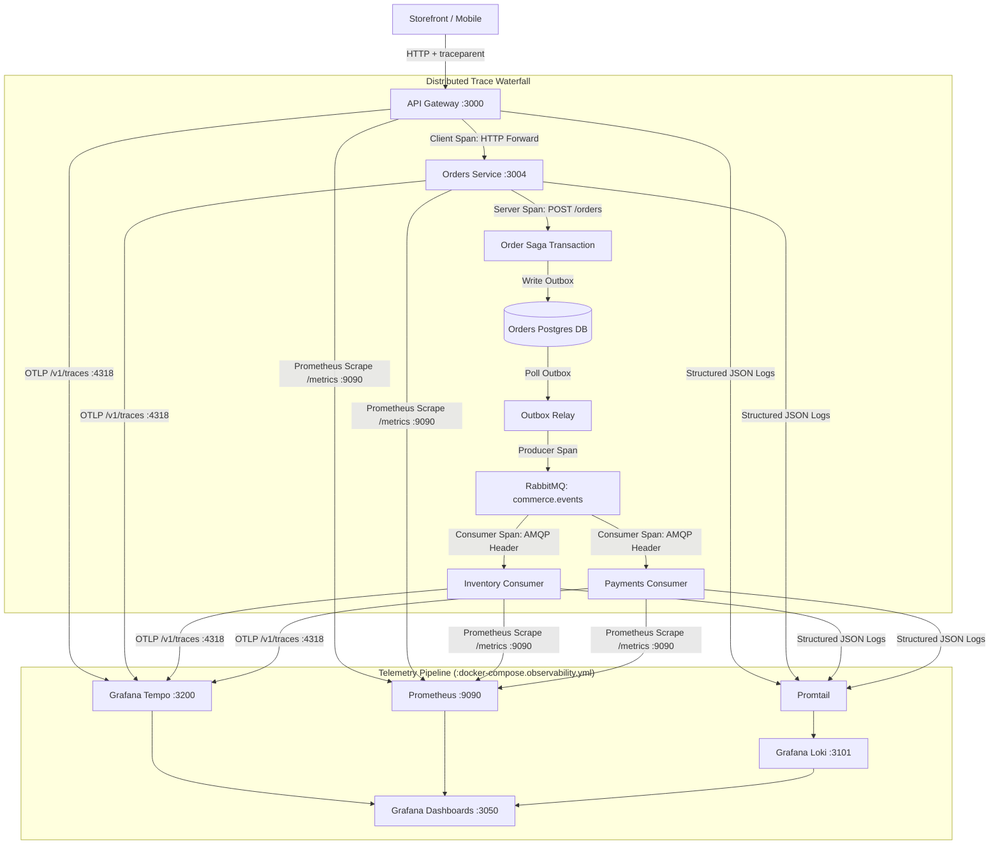
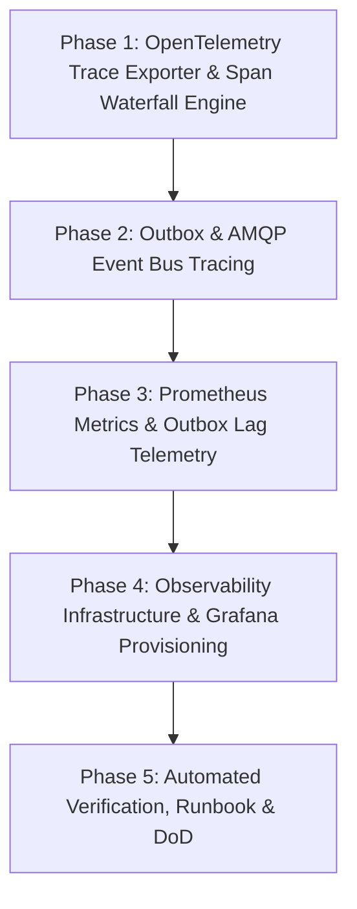

# M19 — Observability & Distributed Tracing Plan

> **Executive Summary:**  
> In a distributed microservice mesh spanning 12 services, an API Gateway, and an asynchronous RabbitMQ event bus, isolating bottlenecks, diagnosing cascading failures, and tracing transaction lifecycles requires unified observability.  
> **Milestone 19 delivers enterprise-grade Observability across the three fundamental pillars:**
>
> 1. **Distributed Tracing (OpenTelemetry + Grafana Tempo):** Automatic W3C `traceparent` propagation across HTTP edge proxying, internal RPCs, transactional outbox relays, and AMQP event consumers, visualizing complete end-to-end span waterfalls for order checkout.
> 2. **Metrics & Outbox Telemetry (Prometheus):** Comprehensive RED metrics (Rate, Errors, Duration) and the single most critical distributed consistency metric: **Outbox Lag** (age and depth of pending transactional outbox events).
> 3. **Correlated Structured Logging (Grafana Loki):** Seamless log-to-trace and trace-to-log pivoting in Grafana, connecting log records to specific Tempo trace spans via `traceId`.

---

## 1. Context & Objectives

- **Milestone:** M19 — Observability (R4 Operations & Hardening)
- **Parent Plan:** `docs/PROJECT_PLAN.md` (§8, R4 M19)
- **Prerequisites:**
  - M16 Authorization & RBAC Matrix (`docs/M16_AUTHORIZATION_RBAC_PLAN.md`)
  - M17 Admin Dashboard & Operations Console (`docs/M17_ADMIN_DASHBOARD_PLAN.md`)
  - M18 Resilience & Fault Tolerance (`docs/M18_RESILIENCE_PLAN.md`)
- **Core Acceptance Criterion:** _"One order traced end to end by a single ID, as a span waterfall."_

### Architectural Invariants

1. **W3C Distributed Context Integrity:** Every HTTP request and AMQP message carries standard W3C `traceparent` headers (`00-{traceId}-{spanId}-{flags}`) mounted in Node.js `AsyncLocalStorage`. Trace context is immutable across the transaction boundary.
2. **Span Waterfall Continuity:** Async operations (e.g. `order.created` ➔ `inventory.reserved` ➔ `payment.intent.created`) must not spawn disjoint traces. They must record `producer` and `consumer` spans referencing the originating checkout HTTP trace.
3. **Outbox Lag as Primary Metric:** In an event-driven architecture, outbox relay delay is the primary leading indicator of system degradation. The system must expose `outbox_lag_seconds` and `outbox_pending_count`.
4. **Zero Heavy Native Dependencies:** The tracing and metrics telemetry engine uses pure TypeScript OTLP HTTP/JSON and standard Prometheus exposition formats, avoiding heavy C++ bindings or fragile native binaries.
5. **Pivoting & Correlation:** All structured JSON logs contain `traceId` and `correlationId`, allowing 1-click navigation in Grafana between logs (Loki) and traces (Tempo).

---

## 2. Observability Architecture

---

## 3. Implementation Phases

---

### Phase 1: OpenTelemetry Trace Exporter & Span Waterfall Engine

- **Span Management Engine (`libs/common/src/tracing/`):**
  - Implement `TraceSpan` with attributes, start/end timestamps, span kinds (`SERVER`, `CLIENT`, `PRODUCER`, `CONSUMER`), status codes, and error events.
  - Implement lightweight OTLP HTTP/JSON exporter targeting Tempo (`http://tempo:4318/v1/traces` or env `OTEL_EXPORTER_OTLP_ENDPOINT`).
- **HTTP Gateway & Service Instrumentation:**
  - Integrate with `LoggingInterceptor` to record `SERVER` spans for all incoming microservice requests.
  - Integrate with API Gateway `ProxyService` to record `CLIENT` spans for upstream hops and inject W3C `traceparent`.

---

### Phase 2: Outbox & AMQP Event Bus Tracing

- **Transactional Outbox Tracing (`libs/outbox/src/`):**
  - Ensure `OutboxRelay` records `PRODUCER` spans when publishing events from Postgres to RabbitMQ.
  - Stash the parent span's context into the message envelope and AMQP headers.
- **RabbitMQ Consumer Tracing (`libs/rabbitmq/src/`):**
  - Ensure `RabbitMQService.consume()` creates a `CONSUMER` span linked to the message's `traceparent`.
  - Propagate trace context into handler execution so domain events and subsequent outbox writes stay in the same trace tree.

---

### Phase 3: Prometheus Metrics & Outbox Lag Telemetry

- **Prometheus Metrics Engine (`libs/common/src/metrics/`):**
  - Implement `MetricsRegistry`, `Counter`, `Gauge`, and `Histogram` in pure TypeScript.
  - Expose `GET /metrics` on API Gateway and microservices.
- **Core RED & Consistency Metrics:**
  - `http_requests_total{method, route, status_code, service}`
  - `http_request_duration_seconds{method, route, status_code, service}`
  - `outbox_pending_count{service}`
  - `outbox_lag_seconds{service}` (age of oldest pending unpublished event)
  - `outbox_published_total{service, event_type}`
  - `circuit_breaker_state{service_key}` and `dlq_messages_count{queue}`

---

### Phase 4: Observability Infrastructure & Grafana Provisioning

- **Infrastructure Scrape Configuration:**
  - Update `observability/prometheus/prometheus.yaml` to scrape Gateway (`:3000`) and core microservices.
  - Verify Tempo OTLP receiver (`:4318`) and Loki log ingestion (`:3101`).
- **Grafana Dashboards:**
  - Provision `observability/grafana/dashboards/commerce-dashboard.json`:
    - Service mesh RED metrics (throughput, error rates, p95/p99 latency).
    - Outbox relay performance and lag gauges.
    - Live trace waterfall queries linked directly to logs.
- **Admin System Dashboard Integration:**
  - Add Observability links in `admin/app/system/page.tsx` for quick access to Grafana (`:3050`), Prometheus (`:9090`), and Tempo trace searches.

---

### Phase 5: Automated Verification, Runbook & Definition of Done

- **Automated Test Suites:**
  - Unit tests for span creation, OTLP serialization, and context inheritance.
  - Prometheus `/metrics` exposition formatting tests.
  - Outbox lag calculation tests.
  - End-to-end trace waterfall test verifying Gateway ➔ Orders ➔ Outbox ➔ RabbitMQ trace continuity.
- **Runbook & Documentation:**
  - Create `docs/OBSERVABILITY_RUNBOOK.md` detailing troubleshooting, PromQL queries, and trace waterfall analysis.
  - Update Definition of Done checklist.

---

## 4. Definition of Done for M19

- [ ] All 5 phases implemented and verified.
- [ ] Distributed W3C `traceparent` context propagated across Gateway, HTTP RPCs, and RabbitMQ events.
- [ ] OTLP spans exported to Tempo creating complete span waterfalls for order transactions.
- [ ] `/metrics` endpoint exposed across services collecting HTTP RED metrics and outbox lag.
- [ ] Prometheus scrape configuration and Grafana dashboards provisioned and operational.
- [ ] Structured JSON logs in Loki correlate with Tempo traces via `traceId`.
- [ ] Automated tests pass with 0 failures.
- [ ] Whole-repo linting and formatting pass with 0 errors.
- [ ] Secrets scan passes (`bash scripts/scan-secrets.sh`).
