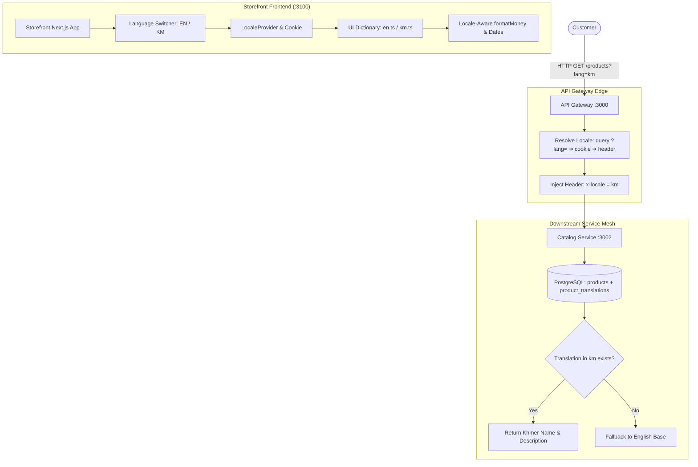
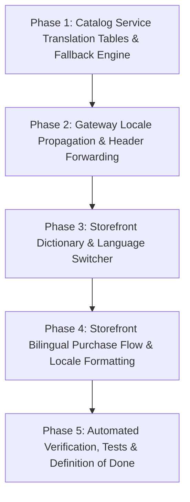

# M20 — Internationalisation & Localisation (i18n) Plan

> **Executive Summary:**  
> Expanding an e-commerce platform beyond a single domestic market requires first-class internationalisation across both the backend data layer and the storefront user experience.  
> **Milestone 20 delivers complete end-to-end multi-language support (English `en` and Khmer `km`)**:
>
> 1. **Database-Driven Content Localisation:** Dedicated PostgreSQL translation tables (`product_translations`, `category_translations`) in `catalog-service` with automated fallback to base English content.
> 2. **Edge Locale Resolution & Propagation:** The API Gateway resolves customer language preferences (URL param `?lang=`, cookie, or `Accept-Language`) and propagates the `x-locale` context header across internal microservice calls.
> 3. **Bilingual Storefront & UI Dictionary Engine:** Comprehensive translation dictionary system (`en` / `km`) with seamless language switching and persistent locale preferences.
> 4. **Locale-Aware Formatting:** Internationalised currency (`Intl.NumberFormat`) and date/time formatting adapting cleanly across locales without float math or precision loss.
> 5. **Bilingual Purchase Flow:** Complete checkout journey from product discovery to order tracking fully localized in both languages.

---

## 1. Context & Objectives

- **Milestone:** M20 — i18n (Release 5: Scale and Reach)
- **Parent Plan:** `docs/PROJECT_PLAN.md` (§8, R5 M20)
- **Prerequisites:**
  - R1: Core Commerce & Saga Orchestration (`M0`–`M6`)
  - R2: Real Checkout (`M7`–`M11`)
  - R3: Discovery & Trust (`M12`–`M15`)
  - R4: Operations & Hardening (`M16`–`M19`)
- **Core Acceptance Criterion:** _"Full purchase flow in two languages."_

### Target Languages & Locales

| Locale Code | Language Name | Native Name | Default Currency | Number/Date Formatting            |
| :---------: | :------------ | :---------- | :--------------: | :-------------------------------- |
|    `en`     | English       | English     |      `USD`       | `en-US` (`$19.99`, `MM/DD/YYYY`)  |
|    `km`     | Khmer         | ភាសាខ្មែរ   |  `USD` / `KHR`   | `km-KH` (`19.99 $`, `DD/MM/YYYY`) |

---

## 2. Architectural Invariants

1. **Dedicated Translation Tables over JSONB:** Following `docs/IMPLEMENTATION_PLAN.md` §6, product and category translations are stored in normalized relation tables (`product_translations`, `category_translations`) keyed by `(entity_id, locale)`. This maintains referential integrity, indexing flexibility, and clean schema migrations.
2. **Transparent Fallback Strategy:** If a translation for a requested locale (`km`) is not yet published, the backend queries automatically fall back to the base English name and description without returning 404 or empty strings.
3. **W3C/RFC Locale Headers:** Internal communication standardizes on the `x-locale` request header, propagated by the API Gateway downstream to all services (`catalog-service`, `search-service`, etc.).
4. **Zero Float Money Precision:** Currency rendering combines minor-unit integer arithmetic (`amountMinor / 10^exponent`) with locale-aware `Intl.NumberFormat(locale, { style: 'currency', currency })`.
5. **Zero Heavy i18n Dependencies:** Both backend and storefront use lightweight TypeScript dictionary lookups and standard ECMAScript `Intl` APIs without bloated third-party runtimes.

---

## 3. i18n Architecture

---

## 4. Implementation Phases

---

### Phase 1: Catalog Service Translation Tables & Fallback Engine (`catalog-service`)

- **Database Migration:**
  - Create `1735006000000-CreateCatalogTranslations.ts`:
    - `product_translations` table (`id`, `product_id`, `locale`, `name`, `description`, `created_at`, `updated_at`).
    - Unique composite index on `(product_id, locale)`. Foreign key to `products(id)` ON DELETE CASCADE.
    - `category_translations` table (`id`, `category_id`, `locale`, `name`, `description`, `created_at`, `updated_at`).
    - Unique composite index on `(category_id, locale)`. Foreign key to `categories(id)` ON DELETE CASCADE.
- **TypeORM Entities:**
  - Create `ProductTranslationEntity` and `CategoryTranslationEntity`.
- **Service Layer & Query Resolvers:**
  - Update `ProductsService.findBySlug(slug, locale)` and `ProductsService.findAll(query, locale)`:
    - If `locale` is passed (e.g. `km`), join or query translation records.
    - Apply fallback: `name = translation.name ?? product.name`.
  - Update `CategoriesService.findAll(locale)` to return localized category names.
- **Database Seed:**
  - Update `apps/catalog-service/src/database/seed.ts` with authentic Khmer translations for all 3 categories and 12 products.

---

### Phase 2: Gateway Locale Propagation & Header Forwarding (`api-gateway`)

- **Edge Locale Detection:**
  - Inspect query parameter `?lang=` / `?locale=`, cookie `commerce_locale`, and `Accept-Language` header.
  - Normalize to supported locales (`en`, `km`).
- **Proxy Forwarding:**
  - Ensure `ProxyService` forward `x-locale` and `Accept-Language` headers to all downstream services.
  - Forward `?locale=` query parameter on catalog and search proxy calls.
- **OpenAPI & Swagger Documentation:**
  - Document `?locale` parameter in catalog controller swagger specs.

---

### Phase 3: Storefront Dictionary & Language Switcher (`storefront`)

- **Dictionary Definitions (`storefront/lib/i18n/`):**
  - Create `dictionaries/en.ts` and `dictionaries/km.ts` covering:
    - Navigation: Products, Cart, Search, Account, Login, Admin.
    - Product Grid: Stock status (in stock, out of stock, stock unknown), Price, Sku.
    - Product Detail: Add to cart, Added to cart, Reviews, Rating, Specifications.
    - Cart & Checkout: Subtotal, Shipping, Tax, Discounts, Place Order, Coupon code, Empty cart.
    - Order Status: Order confirmed, Awaiting payment, Items, Shipping Address, Tracking.
- **Context & Hook:**
  - Create `LocaleContext.tsx` and `useTranslation()` hook.
  - Store selected locale in `document.cookie` (`commerce_locale=km; path=/; max-age=31536000`).
- **Header Switcher Component:**
  - Build `LanguageSwitcher.tsx` with dropdown/toggle for `English` and `ភាសាខ្មែរ`.
  - Integrate into `storefront/app/layout.tsx` next to `CurrencySwitcher`.

---

### Phase 4: Storefront Bilingual Purchase Flow & Locale Formatting

- **Locale-Aware Formatting:**
  - Update `formatMoney(amountMinor, currency, exponent, locale)` in `storefront/lib/types.ts`:
    - Format numbers and symbols according to `locale` (`en-US` vs `km-KH`).
  - Update date/time formatting across storefront to use the active locale.
- **Bilingual Page Upgrades:**
  - `storefront/app/page.tsx`: Localized heading, stock badges, product links.
  - `storefront/app/products/[slug]/page.tsx`: Localized description, buttons, tabs, reviews.
  - `storefront/app/search/page.tsx`: Localized search facets and placeholder.
  - `storefront/app/cart/page.tsx`: Localized order summary, payment form, line item names.
  - `storefront/app/orders/[id]/page.tsx`: Localized timeline badges, items breakdown, receipt.

---

### Phase 5: Automated Verification, Tests & Definition of Done

- **Automated Test Suites:**
  - Unit tests in `catalog-service` verifying `product_translations` queries and English fallbacks.
  - Edge proxy test verifying `x-locale` header transmission in `api-gateway`.
  - Storefront dictionary coverage test ensuring all keys in `en.ts` exist in `km.ts`.
  - End-to-end test validating full purchase flow in both English and Khmer.
- **Lint, Format & Security:**
  - Full repo linting and Prettier formatting.
  - Secret scanning (`scan-secrets.sh`).

---

## 5. Definition of Done for M20

- [ ] All 5 phases implemented and verified.
- [ ] Database migration creates `product_translations` and `category_translations` with unique constraints.
- [ ] Seed script loads complete Khmer translations for categories and products.
- [ ] Fallback logic returns base English content when a localized record is missing.
- [ ] API Gateway detects and propagates `x-locale` header to downstream microservices.
- [ ] Storefront features interactive language switcher (`EN` / `KM`) with cookie persistence.
- [ ] `formatMoney` and date displays format according to active locale (`en-US` vs `km-KH`).
- [ ] Full purchase flow (browse, detail, cart, checkout, confirmation) functional in both languages.
- [ ] Automated tests pass with 0 errors.
- [ ] Whole-repo linting and formatting pass with 0 errors.
- [ ] Secrets scan passes (`bash scripts/scan-secrets.sh`).
