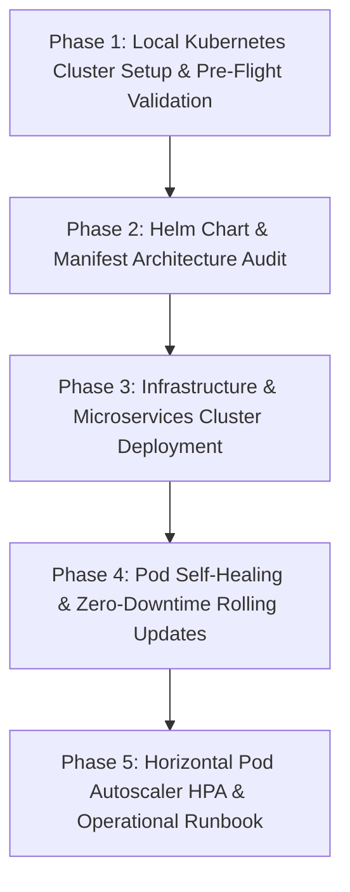

# M21 — Kubernetes, Helm, & Pod Auto-Scaling Plan

> **Executive Summary:**  
> Milestone 21 transitions the e-commerce microservices platform from single-host Docker Compose into an enterprise-grade, container-orchestrated **Kubernetes (K8s)** architecture.  
>
> **Core Acceptance Criterion (§8 R5 M21):**  
> *"Whole stack runs on K8s; a killed pod self-heals."*

---

## 1. Context & Objectives

- **Milestone:** M21 — Kubernetes Deployment & Orchestration (Release 5: Scale and Reach)
- **Parent Plan:** [`docs/PROJECT_PLAN.md`](file:///d:/Year2/Microservices/Order‑Inventory‑Payment%20Microservices/ecommerce-microservices/docs/PROJECT_PLAN.md) (§8, R5 M21)
- **Local Environment:** Windows, Docker Engine 29.5.2, `kubectl` v1.34.1, `helm` v4.3.0, `k3d` v5.9.0 (K3s in Docker).
- **Core Goals:**
  1. Provision a lightweight local multi-node Kubernetes cluster using `k3d`.
  2. Package and validate all 11 NestJS backend microservices, gateway, and infrastructure via **Helm Charts** and **K8s Manifests**.
  3. Wire **Liveness (`/api/v1/health`) and Readiness Probes** so dead containers are automatically restarted and unready pods receive no traffic.
  4. Demonstrate **Self-Healing**: Intentionally kill active pods and verify automatic zero-downtime replacement.
  5. Configure and verify **Horizontal Pod Autoscaling (HPA)**, Resource Limits (CPU/Memory), and **Ingress**.

---

## 2. Architecture Overview

```
                                  [ External Ingress / Browser ]
                                                │
                                                ▼ (HTTP Port 8080)
                             ┌─────────────────────────────────────┐
                             │       k3s Traefik / Ingress         │
                             └──────────────────┬──────────────────┘
                                                │
                                                ▼
                             ┌─────────────────────────────────────┐
                             │     api-gateway (ClusterIP:3000)    │
                             │       [Pod 1]        [Pod 2]        │  ◄── HPA (Min: 2, Max: 5)
                             └──────────────────┬──────────────────┘
                                                │
               ┌───────────────────┬────────────┴───────┬───────────────────┐
               ▼                   ▼                    ▼                   ▼
        catalog-service     orders-service       payments-service     inventory-service
         (ClusterIP:3002)    (ClusterIP:3004)     (ClusterIP:3005)     (ClusterIP:3003)
            [Pod 1..3]          [Pod 1..3]           [Pod 1..2]           [Pod 1..2]
               │                   │                    │                   │
               └───────────────────┴──────────┬─────────┴───────────────────┘
                                              │
                                              ▼
                             ┌─────────────────────────────────────┐
                             │  RabbitMQ & Redis (ClusterIP)       │
                             │  PostgreSQL (Neon Managed Cloud DB) │
                             └─────────────────────────────────────┘
```

---

## 3. Implementation Phases



---

### Phase 1: Local Kubernetes Cluster Setup & Pre-Flight Validation
- **Cluster Creation with `k3d`:**
  - Create a dedicated multi-node local cluster (`k3d-commerce-cluster` with 1 server and 2 worker agent nodes).
  - Map host port `8080:80` for ingress traffic.
- **Namespace & Context Setup:**
  - Create the `commerce` namespace.
  - Switch `kubectl` context to the newly created cluster.
  - Verify node health (`kubectl get nodes`).
- **Secret & Config Management:**
  - Create Kubernetes Secrets (`commerce-secrets`) for `JWT_SECRET`, database URLs, and RabbitMQ credentials.
  - Create Kubernetes ConfigMap (`commerce-config`) with centralized service URLs (`http://catalog-service:3002`, etc.).

---

### Phase 2: Helm Chart & Manifest Architecture Audit
- **Helm Template Validation (`deploy/helm/ecommerce-platform`):**
  - Verify and lint [`Chart.yaml`](file:///d:/Year2/Microservices/Order‑Inventory‑Payment%20Microservices/ecommerce-microservices/deploy/helm/ecommerce-platform/Chart.yaml) and [`values.yaml`](file:///d:/Year2/Microservices/Order‑Inventory‑Payment%20Microservices/ecommerce-microservices/deploy/helm/ecommerce-platform/values.yaml).
  - Ensure all microservices are registered: `api-gateway`, `catalog-service`, `inventory-service`, `orders-service`, `payments-service`, `pricing-service`, `shipping-service`, `search-service`, `reviews-service`, `recommendations-service`, `users-service`, `storefront`.
- **Health Probes & Resource Constraints:**
  - Standardize liveness probes (`/api/v1/health`) and readiness probes.
  - Validate CPU & memory requests/limits across all services (CPU: `100m`-`500m`, Memory: `180Mi`-`384Mi`).
- **Dry-run Linting:**
  - Execute `helm lint deploy/helm/ecommerce-platform`.
  - Execute `helm template ecommerce deploy/helm/ecommerce-platform` to verify clean YAML generation without errors.

---

### Phase 3: Infrastructure & Microservices Cluster Deployment
- **Infrastructure Services:**
  - Deploy cluster dependencies: `redis` and `rabbitmq`.
  - Verify database connectivity to Neon PostgreSQL from within the cluster.
- **Application Services Deployment:**
  - Deploy all microservices using Helm / K8s manifests.
  - Monitor rollout status (`kubectl rollout status deployment/... -n commerce`).
  - Verify all pods enter `Running` state and pass both readiness and liveness probes.
- **Inter-Service Communication Verification:**
  - Test internal DNS resolution and API Gateway proxying across services within the cluster.

---

### Phase 4: Pod Self-Healing & Zero-Downtime Rolling Updates
- **Self-Healing Verification:**
  - Identify an active pod (e.g., `catalog-service` or `orders-service`).
  - Send rapid HTTP requests while killing the pod (`kubectl delete pod ... -n commerce --force`).
  - Verify that Kubernetes immediately replaces the pod, and no requests return unhandled 500s.
- **Rolling Update Verification:**
  - Trigger a deployment image/config update (`kubectl rollout restart deployment/api-gateway -n commerce`).
  - Verify rolling update strategy (`maxSurge: 25%`, `maxUnavailable: 0`) keeps traffic flowing seamlessly.

---

### Phase 5: Horizontal Pod Autoscaler (HPA) & Operational Runbook
- **Autoscaler Configuration:**
  - Configure `HorizontalPodAutoscaler` (HPA) targeting CPU utilization threshold (e.g., 70%).
  - Ensure minimum 2 replicas and maximum 5 replicas for critical services (`api-gateway`, `catalog-service`, `orders-service`).
- **Ingress Routing:**
  - Verify public HTTP entry through K3s Ingress routing `/api/v1/*` to `api-gateway`.
- **Operational Documentation:**
  - Create [`docs/KUBERNETES_RUNBOOK.md`](file:///d:/Year2/Microservices/Order‑Inventory‑Payment%20Microservices/ecommerce-microservices/docs/KUBERNETES_RUNBOOK.md) documenting start, stop, scale, rollback, and debugging commands.
- **Definition of Done Validation:**
  - Confirm all M21 acceptance criteria are satisfied.

---

## 4. Definition of Done for M21

- [x] Local Kubernetes cluster (`k3d-commerce-cluster`) provisioned and accessible via `kubectl`.
- [x] Namespace `commerce`, ConfigMap `commerce-config`, and Secrets `commerce-secrets` configured and verified.
- [ ] Helm chart passes `helm lint` and `helm template` with 0 errors.
- [ ] All microservices deployed and healthy in the `commerce` namespace.
- [ ] Liveness and readiness probes active and passing on all deployments.
- [ ] Pod self-healing verified by killing a pod and confirming automatic resurrection.
- [ ] Zero-downtime rolling update verified during rollout restart.
- [ ] Horizontal Pod Autoscaler (HPA) configured for high-traffic services.
- [ ] Operational runbook created in `docs/KUBERNETES_RUNBOOK.md`.
