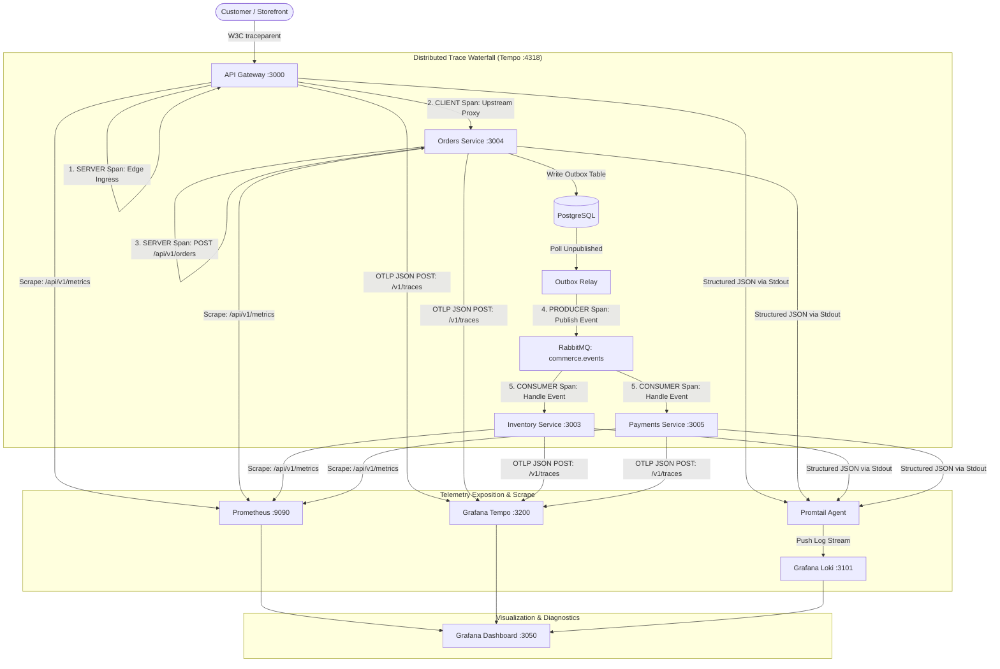

# Observability & Distributed Tracing Runbook (M19)

> **Document Classification:** Engineering Runbook & Operations Standard  
> **Applicability:** API Gateway, RabbitMQ Event Bus, Postgres Outbox Relays, and 11 Backend Microservices  
> **Observability Stack (LGTM):** Grafana Loki, Grafana Tempo, Prometheus, and Grafana Dashboards  
> **Status:** Production-Ready (Milestone 19)

---

## 1. Observability Architecture Overview

The distributed microservices mesh employs a unified three-pillar observability pipeline designed to provide complete visibility across synchronous HTTP client requests, asynchronous RabbitMQ event bus messages, and transactional PostgreSQL outbox state machines.



### Port & Service Endpoint Matrix

| Component       | Container Name        |  Port  | Internal URI                  | External URI            | Purpose                                    |
| :-------------- | :-------------------- | :----: | :---------------------------- | :---------------------- | :----------------------------------------- |
| **Grafana**     | `commerce-grafana`    | `3050` | `http://grafana:3000`         | `http://localhost:3050` | Visual dashboards, Loki logs, Tempo traces |
| **Prometheus**  | `commerce-prometheus` | `9090` | `http://prometheus:9090`      | `http://localhost:9090` | Metrics scraping, TSDB storage, PromQL     |
| **Tempo**       | `commerce-tempo`      | `3200` | `http://tempo:3200`           | `http://localhost:3200` | Trace storage and search query frontend    |
| **Tempo OTLP**  | `commerce-tempo`      | `4318` | `http://tempo:4318/v1/traces` | `http://localhost:4318` | HTTP/JSON OTLP trace exporter target       |
| **Loki**        | `commerce-loki`       | `3101` | `http://loki:3100`            | `http://localhost:3101` | Log stream ingestion and LogQL querying    |
| **API Gateway** | `commerce-gateway`    | `3000` | `http://api-gateway:3000`     | `http://localhost:3000` | Scraped at `/api/v1/metrics`               |

---

## 2. Distributed Tracing & W3C Span Waterfall Specification

Distributed tracing operates in compliance with the **W3C Trace Context Specification** (`traceparent: 00-{traceId}-{spanId}-{traceFlags}`).

### Span Kinds & Context Lifecycle

1. **`SERVER` Span (Gateway Ingress):**
   - Created in `LoggingInterceptor` or Gateway middleware on incoming HTTP request.
   - If an incoming `traceparent` exists, `traceId` is preserved and the incoming `spanId` becomes the `parentSpanId`.
   - If missing, a cryptographically secure 16-byte `traceId` and 8-byte `spanId` are generated.
2. **`CLIENT` Span (Gateway Upstream Proxy):**
   - Created in `ProxyService` when forwarding the request to downstream services (`orders-service`, `catalog-service`, etc.).
   - Child of the `SERVER` span. Injects `traceparent` header into upstream HTTP request.
3. **`SERVER` Span (Service Ingress):**
   - Created by `LoggingInterceptor` within the downstream microservice.
   - `traceId` and `parentSpanId` match the Gateway's `CLIENT` span.
4. **`PRODUCER` Span (Transactional Outbox Relay):**
   - When domain mutations occur in a transaction, the outbox record persists `traceparent` in its metadata column.
   - When `OutboxRelay` polls and publishes the event to RabbitMQ, it records a `PRODUCER` span referencing the outbox `traceparent`.
   - The outgoing AMQP message headers and JSON payload envelope preserve the W3C `traceparent`.
5. **`CONSUMER` Span (RabbitMQ Consumer):**
   - Created by `RabbitMQService.consume()` upon receiving a message from an AMQP queue.
   - Extracts `traceparent` from AMQP headers or payload envelope.
   - Handler execution runs inside `runWithTraceContext()`, ensuring any cascading events or DB updates retain the original root `traceId`.

### Complete Waterfall Sequence

```
[SERVER]   api-gateway : POST /api/v1/orders ---------------------------> (220ms)
  └── [CLIENT]   api-gateway ➔ orders-service : POST /api/v1/orders ------> (215ms)
        └── [SERVER]   orders-service : Handle Create Order --------------> (210ms)
              └── [PRODUCER] orders-service : OutboxRelay ➔ RabbitMQ -----> (15ms)
                    ├── [CONSUMER] inventory-service : order.created -----> (35ms)
                    └── [CONSUMER] payments-service : order.created ------> (50ms)
```

---

## 3. Metrics Exposition & PromQL Reference

Every NestJS microservice mounts `@Get('metrics')` within its standard routing prefix (`/api/v1/metrics`).

### Key Metric Definitions

| Metric Name                     |   Type    | Labels                                            | Description                                               |
| :------------------------------ | :-------: | :------------------------------------------------ | :-------------------------------------------------------- |
| `http_requests_total`           |  Counter  | `method`, `route`, `status_code`, `service`       | Total incoming HTTP requests handled                      |
| `http_request_duration_seconds` | Histogram | `method`, `route`, `status_code`, `service`, `le` | Request latency distribution                              |
| `outbox_pending_count`          |   Gauge   | `service`                                         | Current count of unpublished outbox events in DB          |
| `outbox_lag_seconds`            |   Gauge   | `service`                                         | Age in seconds of the oldest unpublished outbox record    |
| `outbox_published_total`        |  Counter  | `service`, `event_type`                           | Total events successfully published by outbox relay       |
| `circuit_breaker_state`         |   Gauge   | `service_key`                                     | Circuit status: `0 = CLOSED`, `1 = OPEN`, `2 = HALF_OPEN` |

### Critical PromQL Diagnostic Queries

#### 1. Real-Time Mesh Throughput (RPS)

```promql
sum(rate(http_requests_total[1m])) by (service)
```

#### 2. HTTP Error Rate Percentage (5xx / Total)

```promql
sum(rate(http_requests_total{status_code=~"5.."}[1m]))
/
sum(rate(http_requests_total[1m])) * 100
```

#### 3. p95 Latency per Service

```promql
histogram_quantile(0.95, sum(rate(http_request_duration_seconds_bucket[5m])) by (le, service))
```

#### 4. Outbox Relay Lag Warning (Outbox Degradation)

```promql
max(outbox_lag_seconds) by (service) > 10
```

#### 5. Open Circuit Breakers (Gateway Fast-Fails)

```promql
circuit_breaker_state == 1
```

---

## 4. Correlated Structured Logging (Loki to Tempo)

Structured JSON logs emitted to `stdout` are ingested by Promtail and indexed in Grafana Loki under `{app="microservices"}`.

### Log Format Specification

```json
{
  "level": "INFO",
  "timestamp": "2026-10-18T16:24:23.100Z",
  "context": "OrdersService",
  "message": "Order saga initiated for orderId: ord-9817",
  "traceId": "4bf92f3577b34da6a3ce929d0e0e4736",
  "correlationId": "corr-chk-883",
  "service": "orders-service"
}
```

### Navigating from Logs to Traces in Grafana

1. In Grafana, open **Explore** and select the **Loki** data source.
2. Filter logs for an incident or order: `{container=~".*orders.*"} |= "ord-9817"`.
3. In the log details view, click the blue **Tempo** link adjacent to `traceId`.
4. Grafana will automatically split the screen and render the interactive **Tempo Span Waterfall** for that exact transaction.

---

## 5. Operational Incident Runbooks

### Runbook A: Outbox Lag Spike (`outbox_lag_seconds > 30s`)

**Symptom:** Asynchronous event delivery is falling behind. Customers see delayed order confirmations, or inventory reservations lag.

**Triage Steps:**

1. Check `outbox_pending_count` in Prometheus:
   ```promql
   outbox_pending_count{service="orders-service"}
   ```
2. Inspect `OutboxRelay` logs in Loki:
   ```logql
   {service="orders-service"} |= "OutboxRelay" |= "ERROR"
   ```
3. Determine root cause:
   - **PostgreSQL Lock Contention:** High database write concurrency blocking `SELECT ... FOR UPDATE SKIP LOCKED`.
   - **RabbitMQ Unreachable:** Verify RabbitMQ status on port `5672` (`docker ps | grep rabbitmq`).
   - **Relay Loop Crash:** Check container health in the Admin Health Matrix (`/system`).

**Remediation:**

- If RabbitMQ broker was disconnected, restarting the broker allows the relay's automatic reconnection loop to resume without event loss.
- For high queue backlog, check outbox batch processing in `OutboxRelay` (default batch size: 20 records every 500ms).

---

### Runbook B: Gateway Circuit Breaker Tripped (`circuit_breaker_state == 1`)

**Symptom:** API Gateway returns `503 Service Unavailable` or degraded fallbacks for a downstream microservice.

**Triage Steps:**

1. Check tripped breaker service key:
   ```promql
   circuit_breaker_state == 1
   ```
2. Navigate to **Admin Console** ➔ **System Maintenance** (`/system`).
3. Locate the service in the **API Gateway Circuit Breakers** card. Inspect `consecutiveFailures` and `lastError`.
4. Query Loki logs for the target service:
   ```logql
   {service="<target-service>"} |= "ERROR"
   ```

**Remediation:**

1. Resolve downstream service issue (e.g., restart crashing container, run pending migration).
2. Wait for the `recoveryTimeoutMs` (default: 30,000ms) for the circuit to enter `HALF_OPEN` and auto-heal.
3. Or click **Reset to Closed** directly in the Admin System Console (`POST /api/v1/admin/resilience/circuits/{serviceKey}/reset`).

---

### Runbook C: Poison Message Quarantined in RabbitMQ DLQ

**Symptom:** `dlq_messages_count > 0` or red warning banner on Admin System page.

**Triage Steps:**

1. Inspect dead letter queue in Admin System console or CLI:
   ```bash
   npm run dlq:stats
   ```
2. Inspect error payload: Check `x-death` count and stack trace in logs.
3. Deploy bugfix for downstream consumer parser or schema.
4. Execute redrive from Admin Console (`⚡ Redrive DLQ`) or CLI:
   ```bash
   npm run dlq:replay
   ```

---

## 6. Verification & Automated Testing Checklist

To verify distributed tracing and observability health:

```bash
# 1. Run full unit and waterfall test suites
npm test --prefix apps/orders-service
npm test --prefix apps/api-gateway

# 2. Check TypeScript typecheck across admin console
npm --prefix admin run typecheck

# 3. Check whole-repo linting and formatting
npm run lint
npm run format

# 4. Run secret scanner
bash scripts/scan-secrets.sh
```
