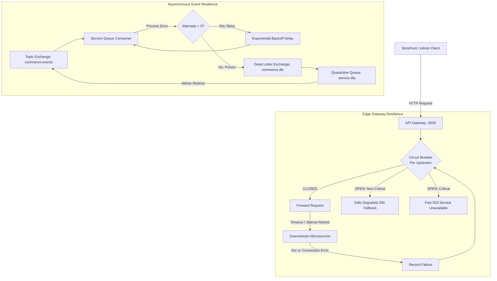

# Microservice Resilience & Fault Tolerance Operational Runbook

> **Scope:** Operational procedures, failure modes, degradation policies, and administrative redrive workflows for synchronous HTTP and asynchronous AMQP microservice traffic across the eCommerce mesh.

---

## 1. Resilience Architecture Overview

The eCommerce mesh consists of 12 NestJS microservices communicating synchronously via the **API Gateway** (`:3000`) and asynchronously via the **RabbitMQ Event Bus** (`:5672`).



---

## 2. Synchronous Edge Resilience (API Gateway)

### 2.1 Circuit Breaker Engine

Each upstream microservice is shielded by an isolated in-memory `CircuitBreaker` instance managed by `CircuitBreakerRegistry`:

- **States:**
  - `CLOSED` (Normal): Requests flow freely. Consecutive failures counter resets to `0` upon each successful response.
  - `OPEN` (Tripped): Upstream is failing. Incoming requests bypass network transport entirely and fast-fail (< 15ms) or degrade gracefully.
  - `HALF_OPEN` (Trialing): After `recoveryTimeoutMs` has elapsed, the breaker allows up to `halfOpenMaxTrials` probe requests to test upstream recovery. If probes succeed, the breaker recovers to `CLOSED`. If any probe fails, it trips immediately back to `OPEN`.

### 2.2 Threshold Configuration (`apps/api-gateway/src/config/services.config.ts`)

| Parameter           | Env Variable                           | Default       | Purpose                                                               |
| ------------------- | -------------------------------------- | ------------- | --------------------------------------------------------------------- |
| `failureThreshold`  | `CIRCUIT_BREAKER_FAILURE_THRESHOLD`    | `5`           | Consecutive transport/5xx failures required to trip circuit to `OPEN` |
| `recoveryTimeoutMs` | `CIRCUIT_BREAKER_RECOVERY_TIMEOUT_MS`  | `15000` (15s) | Time spent in `OPEN` before transitioning to `HALF_OPEN` probe state  |
| `halfOpenMaxTrials` | `CIRCUIT_BREAKER_HALF_OPEN_MAX_TRIALS` | `2`           | Consecutive successful trials needed in `HALF_OPEN` to close circuit  |
| `upstreamTimeoutMs` | `UPSTREAM_TIMEOUT_MS`                  | `5000` (5s)   | Hard ceiling per upstream HTTP request before socket abort            |
| `upstreamRetries`   | `UPSTREAM_RETRIES`                     | `1`           | Idempotent `GET` retries with randomized exponential jitter           |

### 2.3 Route Degradation & Fallback Policies

To prevent cascading outages from ruining the customer experience, routes are strictly partitioned into **Non-Critical (Graceful Degradation)** and **Critical (Fail-Fast)**:

| Path Pattern                               | HTTP Method | Policy               | Fallback Response                                                        | Diagnostic Headers                                         |
| ------------------------------------------ | ----------- | -------------------- | ------------------------------------------------------------------------ | ---------------------------------------------------------- |
| `/api/v1/recommendations/*`                | `GET`       | Graceful Fallback    | `{ items: [], total: 0 }`                                                | `x-degraded: true`<br/>`x-degraded-reason: circuit_open_*` |
| `/api/v1/reviews/products/:id`             | `GET`       | Graceful Fallback    | `{ reviews: [], total: 0, rating: 0, ratingBreakdown: {...} }`           | `x-degraded: true`                                         |
| `/api/v1/reviews/products/:id/eligibility` | `GET`       | Graceful Fallback    | `{ canReview: false, verifiedPurchase: false }`                          | `x-degraded: true`                                         |
| `/api/v1/search*`                          | `GET`       | Graceful Fallback    | `{ hits: [], total: 0, page: 1, limit: 10, facets: { categories: [] } }` | `x-degraded: true`                                         |
| `/api/v1/orders*`                          | `POST`      | **Strict Fail-Fast** | `503 Service Unavailable` with `Retry-After`                             | `x-circuit-breaker-status: OPEN`                           |
| `/api/v1/payments*`                        | `POST`      | **Strict Fail-Fast** | `503 Service Unavailable` with `Retry-After`                             | `x-circuit-breaker-status: OPEN`                           |
| `/api/v1/auth*`                            | Any         | **Strict Fail-Fast** | `503 Service Unavailable` with `Retry-After`                             | `x-circuit-breaker-status: OPEN`                           |
| `/api/v1/inventory*`                       | Any         | **Strict Fail-Fast** | `503 Service Unavailable` with `Retry-After`                             | `x-circuit-breaker-status: OPEN`                           |

> [!IMPORTANT]
> **Zero Degradation on Mutating Paths:** Write operations (`POST`, `PUT`, `DELETE`) and critical transactional boundaries are NEVER faked with synthetic 200 responses. Doing so would violate accounting, ledger, and inventory invariants.

---

## 3. Asynchronous Event Resilience (RabbitMQ)

### 3.1 Dead Letter Exchange (`commerce.dlx`) & DLQ Quarantining

- **Exchange:** `commerce.dlx` (Topic exchange).
- **Dead Letter Queues:** Each service has a dedicated dead-letter queue `${queue}.dlq` (e.g. `orders-service.dlq`).
- **Retry Mechanism:**
  1. Consumer encounters an unhandled runtime error.
  2. The message is republished to an exponential backoff retry queue with incremented header `x-retry-count`.
  3. When `x-retry-count >= 3`, the message is identified as a poison pill.
  4. The poison pill is routed directly to `${queue}.dlq` with diagnostic quarantine headers:
     - `x-quarantine-reason: MaxRetriesExceeded`
     - `x-quarantine-error`: Error stack trace / exception message.
     - `x-quarantine-at`: ISO 8601 timestamp.
     - `x-original-routing-key`: The original event routing key (e.g. `order.confirmed`).
  5. The poison pill is acknowledged (`ack`) from the active consumption queue to prevent queue stalling.

---

## 4. Administrative Control Operations

### 4.1 Admin Web Dashboard Console (`/system`)

The System Maintenance page at `http://localhost:3001/system` provides live operational control:

1. **Circuit Breakers Console:**
   - Displays real-time state for all 11 upstream services (`CLOSED` 🟢, `OPEN` 🔴, `HALF_OPEN` 🟡).
   - Shows consecutive failure counts, trial progress, and failure timestamps.
   - **Reset Breaker Button:** Manually forces an open circuit back to `CLOSED` after upstream recovery.
   - **Reset All Circuits Button:** Mass reset for all service circuits simultaneously.
2. **Dead Letter Queue (DLQ) Monitor:**
   - Real-time message depth indicators for both active service queues and quarantined `.dlq` queues.
   - Status badge alerts: `HEALTHY` 🟢, `STANDBY` ⚪, or `⚠️ HAS POISON PILLS` 🔴.
   - **⚡ Redrive DLQ Button:** Automatically pulls quarantined messages, cleans quarantine metadata headers, re-stamps `x-replayed-at`, and publishes them back to `commerce.events` for processing.
   - **Purge Button:** Safely flushes unrecoverable garbage messages from quarantine.

### 4.2 CLI Operations Tools

For terminal operations or automated CI/CD maintenance:

```bash
# Check DLQ status across all queues
npm run dlq:stats

# Redrive messages from a quarantined DLQ (default limit: 50)
npm run dlq:replay -- --queue=orders-service --limit=25

# Purge messages from a quarantined DLQ
npm run dlq:purge -- --queue=orders-service
```

---

## 5. Failure Mode Drills & Verification

### Drill 1: Killing Non-Critical Service (Recommendations)

```bash
# 1. Stop recommendations microservice
docker compose stop recommendations-service

# 2. Curl product recommendations endpoint through gateway
curl -i http://localhost:3000/api/v1/recommendations/products/prod_123

# Expected Result:
# HTTP/1.1 200 OK
# x-degraded: true
# x-degraded-reason: transport_error_recommendationsServiceUrl
# Content-Type: application/json
# {"items":[],"total":0}
```

_Outcome:_ Storefront product detail pages continue rendering with 200 OK without user-visible breakage.

### Drill 2: Circuit Breaker Fast-Fail on Hard Outage (Catalog Service)

```bash
# 1. Stop catalog microservice
docker compose stop catalog-service

# 2. Send 5 failing requests to trip the circuit
for i in {1..5}; do curl -s -o /dev/null http://localhost:3000/api/v1/catalog/products; done

# 3. Next request fails fast in < 15ms without touching network socket:
curl -i http://localhost:3000/api/v1/catalog/products

# Expected Result:
# HTTP/1.1 503 Service Unavailable
# x-circuit-breaker-status: OPEN
# retry-after: 15
# {"statusCode":503,"error":"Service Unavailable","circuitStatus":"OPEN",...}
```

### Drill 3: Recovering from Poison Message Quarantine

```bash
# 1. Inspect DLQ depths via admin API or UI
curl -H "Authorization: Bearer <ADMIN_JWT>" http://localhost:3000/api/v1/admin/resilience/dlq

# 2. Trigger redrive of quarantined events
curl -X POST -H "Authorization: Bearer <ADMIN_JWT>" \
  http://localhost:3000/api/v1/admin/resilience/dlq/orders-service/replay

# Expected Result:
# {"ok":true,"replayed":3,"queue":"orders-service","dlqQueue":"orders-service.dlq"}
```
