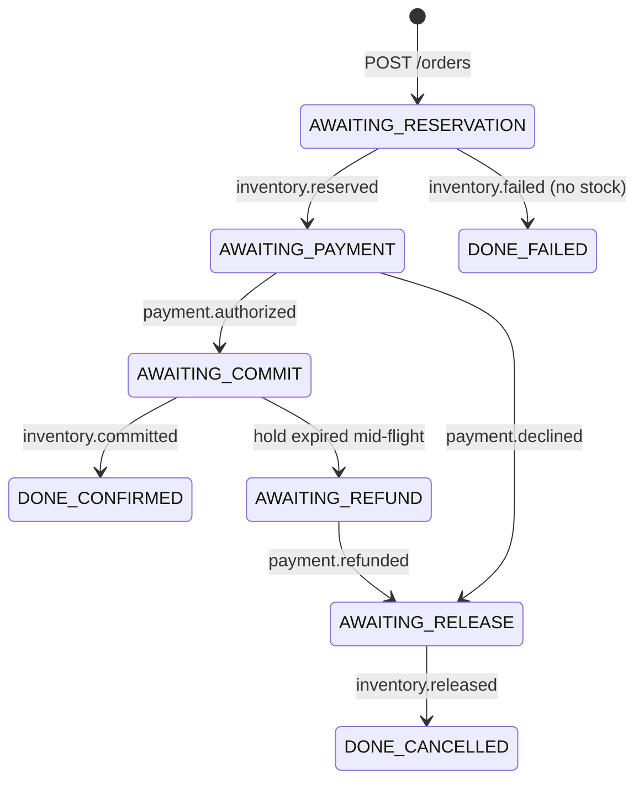
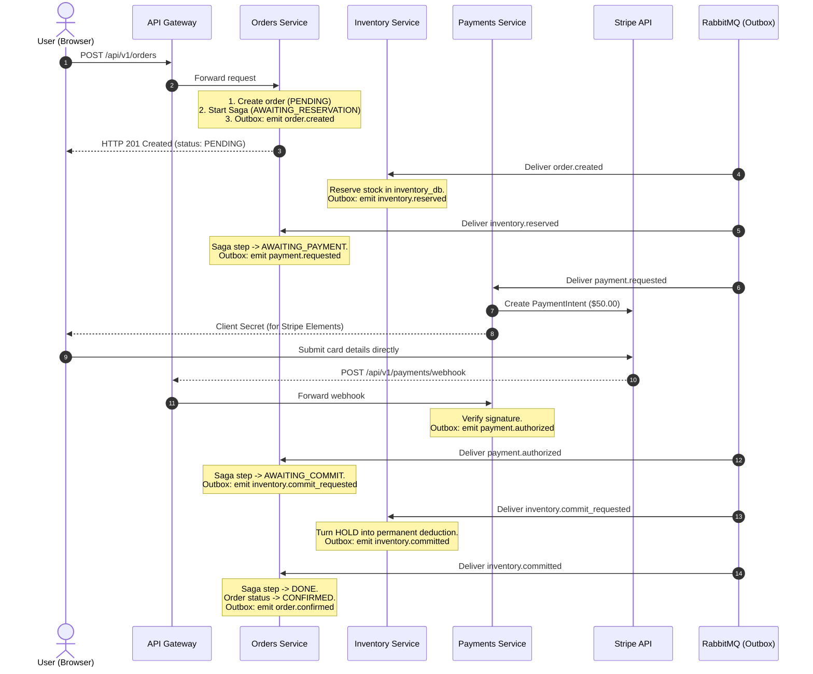
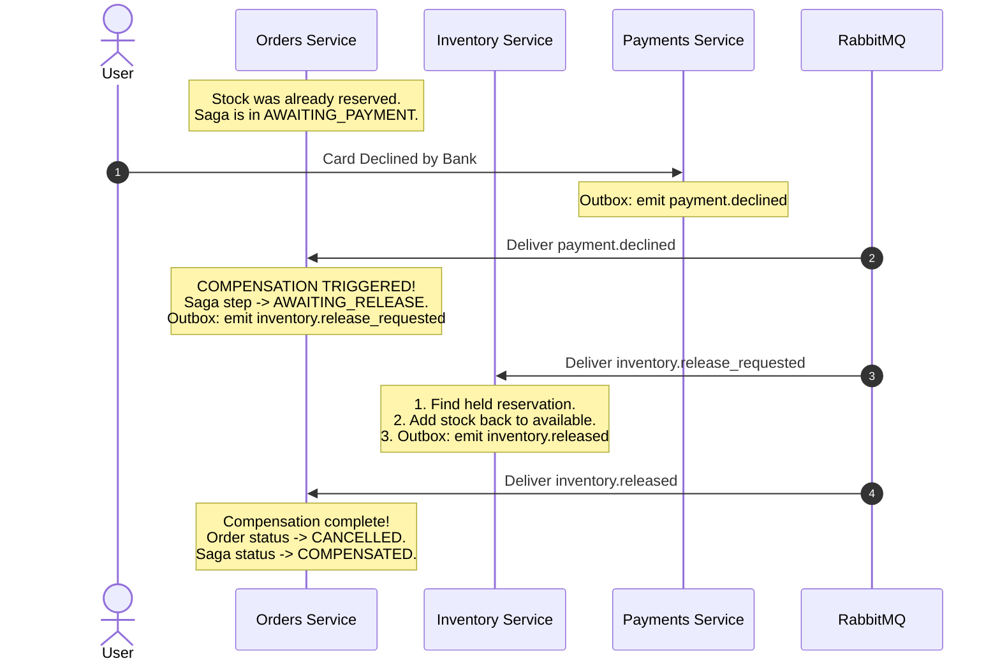

# Master Self-Study Guide: E-Commerce Microservices & Distributed Systems

> **Audience:** Computer Science / Software Engineering Student (Year 2+)  
> **Repository:** `ecommerce-microservices`  
> **Goal:** Understand every design pattern, distributed systems concept, architecture decision, and line of code that powers this production-grade microservices project.

---

## Table of Contents

### Part I: Distributed Systems Architecture (The Core Engine)
1. [The Big Picture: Why Not Just Build a Monolith?](#1-the-big-picture-why-not-just-build-a-monolith)
2. [The Core Problem: Distributed Transactions & The Death of ACID](#2-the-core-problem-distributed-transactions--the-death-of-acid)
3. [Architecture Overview: Who Does What?](#3-architecture-overview-who-does-what)
4. [Pillar 1: The Saga Pattern (Orchestration vs Choreography)](#4-pillar-1-the-saga-pattern-orchestration-vs-choreography)
5. [Pillar 2: The Transactional Outbox Pattern](#5-pillar-2-the-transactional-outbox-pattern)
6. [Pillar 3: Idempotent Consumers (At-Least-Once Delivery)](#6-pillar-3-idempotent-consumers-at-least-once-delivery)
7. [Pillar 4: Concurrency & Contention (Coupons, Holds & Sweeps)](#7-pillar-4-concurrency--contention-coupons-holds--sweeps)
8. [Service-by-Service Deep Dive (The Code Tour)](#8-service-by-service-deep-dive-the-code-tour)
9. [Step-by-Step Order Lifecycle (Sequence Diagrams)](#9-step-by-step-order-lifecycle-sequence-diagrams)

### Part II: Production DevOps & Site Reliability Engineering (SRE)
10. [Pillar 5: Production CI/CD & Path-Based Docker Matrix](#10-pillar-5-production-cicd--path-based-docker-matrix)
11. [Pillar 6: Full-Stack Distributed Tracing & Observability](#11-pillar-6-full-stack-distributed-tracing--observability)
12. [Pillar 7: RabbitMQ Production Hardening & Dead-Letter Queues (DLQ)](#12-pillar-7-rabbitmq-production-hardening--dead-letter-queues-dlq)
13. [Pillar 8: Cloud-Native Deployments (Kubernetes, Helm, KEDA & Terraform)](#13-pillar-8-cloud-native-deployments-kubernetes-helm-keda--terraform)
14. [Pillar 9: Zero-Trust Security, Secret Management & Container Hardening](#14-pillar-9-zero-trust-security-secret-management--container-hardening)

### Part III: Practical Mastery & Glossary
15. [Master Hands-On Lab Experiments (The Complete Local Runbook)](#15-master-hands-on-lab-experiments-the-complete-local-runbook)
16. [Master Glossary of Essential Terms](#16-master-glossary-of-essential-terms)

---

## 1. The Big Picture: Why Not Just Build a Monolith?

In typical university coursework, you build a **monolithic application**:
- A single backend server (e.g., Express, NestJS, Spring Boot, or Django).
- A single database (e.g., PostgreSQL or MySQL).
- Every table (`users`, `products`, `orders`, `inventory`, `payments`) lives in the **same database**.

### How checkout works in a monolith:
```sql
BEGIN TRANSACTION;
  -- 1. Deduct 2 units of product stock
  UPDATE inventory SET stock = stock - 2 WHERE product_id = 'XYZ' AND stock >= 2;

  -- 2. Create the order
  INSERT INTO orders (id, user_id, total) VALUES ('ord_123', 'usr_1', 5000);

  -- 3. Charge the customer's credit card
  -- (If this fails, throw an error)

COMMIT; -- If anything fails, ROLLBACK undoes EVERYTHING automatically!
```

This is called **ACID Atomicity**: either everything succeeds, or the database automatically rolls back every change as if nothing ever happened.

### The Real-World Dilemma:
As companies scale:
1. **Independent Teams:** A team of 50 developers working on a single repository constantly conflicts on database schemas and deployments.
2. **Scalability:** The catalog service gets 10,000 read requests per second (browsing items), while the checkout service gets 50 writes per second. In a monolith, you have to scale the entire monolithic application together.
3. **Database-per-Service Pattern:** To make microservices truly independent, **each microservice owns its own private database**. No other service can read or write to another service's database directly!

---

## 2. The Core Problem: Distributed Transactions & The Death of ACID

The moment you separate your app into:
- `orders-service` (owns `orders_db`)
- `inventory-service` (owns `inventory_db`)
- `payments-service` (owns `payments_db` + communicates with Stripe's external API)

**You can NO LONGER do a SQL `BEGIN TRANSACTION` across them!**

### The "Split-Brain" / Orphaned Stock Disaster (The Experiment in ADR-0002)
Imagine writing simple synchronous code in `orders-service`:

```typescript
// NAIVE CODE (DO NOT DO THIS)
async function checkout(orderData) {
  // Step 1: Call inventory-service via HTTP
  await httpClient.post('http://inventory-service/reserve', { qty: 2 });
  // (Inventory committed in inventory_db: stock is now held!)

  // Step 2: Call payments-service via HTTP
  await httpClient.post('http://payments-service/charge', { amount: 50 });
  // OOPS! Card declined! Or network blip! Or payments-service crashed!

  // Step 3: Throw error
  throw new Error("Payment failed!");
}
```

What happened in the database?
1. `inventory_db` has already decremented or reserved the stock.
2. `orders-service` threw an error and created a `status = 'failed'` order.
3. **The 2 reserved units are permanently stuck (orphaned) in `inventory_db`!**
4. Nobody released them. Customers browsing the store cannot buy those 2 items because the inventory thinks they are reserved.

Why not use **Two-Phase Commit (2PC)**?
- 2PC locks database rows across multiple servers over the network.
- If one network connection is slow or a node hangs, the entire system grinds to a halt.
- Furthermore, **Stripe cannot participate in a 2PC transaction**. You cannot tell Stripe: *"Hey Stripe, prepare to charge this card, lock the money, wait 10 seconds for my database, and then commit."*

Therefore, distributed systems must use **Eventual Consistency** and the **Saga Pattern**.

---

## 3. Architecture Overview: Who Does What?

This project consists of 9 distinct backend applications, a Next.js frontend, a message broker, and in-memory cache:

```
                  +-----------------------------------+
                  |   Browser / Next.js Storefront    |
                  |          (:3100)                  |
                  +-----------------+-----------------+
                                    | HTTP
                                    v
                  +-----------------------------------+
                  |            API GATEWAY            |
                  |              (:3000)              |
                  |  JWT Auth, Rate Limit, Routing    |
                  +-----------------+-----------------+
                                    |
     +-----------------+------------+------------+-----------------+
     | HTTP            | HTTP                    | HTTP            | HTTP
     v                 v                         v                 v
+-----------+    +-----------+             +-----------+     +-----------+
| users     |    | catalog   |             | cart      |     | pricing   |
| (:3001)   |    | (:3002)   |             | (:3006)   |     | (:3007)   |
| users_db  |    | catalog_db|             | Redis + db|     | pricing_db|
+-----------+    +-----------+             +-----------+     +-----------+
                                                 | (order created)
                                                 v
                                           +-----------+
                                           | orders    | (:3004, orders_db)
                                           | SAGA      |
                                           +-----+-----+
                                                 |
                   RabbitMQ (Event Bus)          | Events & Commands
         ========================================+=======================
             |                          |                         |
             v                          v                         v
     +---------------+          +---------------+         +---------------+
     | inventory     |          | payments      |         | pricing       |
     | (:3003)       |          | (:3005)       |         | (:3007)       |
     | inventory_db  |          | payments_db   |         | coupon claims |
     +---------------+          +---------------+         +---------------+
```

### The System Roster:

| Service | Port | Database | Primary Responsibility |
|---|---|---|---|
| **api-gateway** | 3000 | None | Single public entrance. Validates JWT tokens, adds `x-correlation-id` and W3C `traceparent`, enforces rate limits, proxies requests, passes Stripe webhooks raw body. |
| **users-service** | 3001 | `users_db` | User registration, password hashing (bcrypt), login, customer profile management. |
| **catalog-service** | 3002 | `catalog_db` | Products catalog, categories, descriptions, images, read-heavy query patterns. |
| **inventory-service** | 3003 | `inventory_db` | Real-time stock counts, reservations (holds), commit stock, release stock, 15-minute expiry sweeper. |
| **orders-service** | 3004 | `orders_db` | Order records and the **Checkout Saga Orchestrator**. Coordinates the entire checkout sequence. |
| **payments-service** | 3005 | `payments_db` | Stripe integration, PaymentIntent creation, webhook signature verification, refunds. |
| **cart-service** | 3006 | Redis + `cart_db` | Guest carts (stored in Redis with TTL) & signed-in user carts (stored in Postgres). Merges guest cart into user cart on login. |
| **pricing-service** | 3007 | `pricing_db` | Tax computation (US sales tax vs EU VAT inclusive), automated promotions, and highly-concurrent coupon redemptions. |
| **shipping-service** | 3008 | `shipping_db` | Shipping address validation, carrier rating, shipment fulfillment lifecycle. |
| **search-service** | 3009 | OpenSearch | OpenSearch full-text search, fuzzy search, facet aggregations, asynchronous CQRS projections. |
| **reviews-service** | 3010 | `reviews_db` | Verified purchaser reviews, star ratings, moderation lifecycle, rating rollup calculations. |
| **recommendations-service** | 3012 | `recommendations_db` | Real-time co-purchase frequency matrix, "Customers Also Bought" recommendations. |
| **storefront** | 3011 | None | Next.js 14 web client with AlsoBought recommendations, React, Tailwind CSS, Stripe Elements checkout. |

### Supporting Infrastructure:
- **RabbitMQ (Port 5672 / 15672):** Topic-based message broker (`commerce.events` exchange) with Dead Letter Exchange (`commerce.dlx`) and exponential backoff retry.
- **Redis (Port 6380 on host / 6379 in docker network):** Ultra-fast key-value store used for anonymous guest shopping carts.
- **OpenSearch (Port 9200):** Distributed full-text search engine for high-performance product discovery.
- **Neon PostgreSQL:** Serverless cloud PostgreSQL. **Rule: One database per microservice.** No service ever queries another service's database directly!
- **Observability Stack (Port 3050):** Grafana, Prometheus, Loki, Promtail, and Tempo for production monitoring, log aggregation, and distributed tracing.

---

## 4. Pillar 1: The Saga Pattern (Orchestration vs Choreography)

### What is a Saga?
A **Saga** is a sequence of local transactions. Each local transaction updates the database within a single service and publishes an event or message.
If a local transaction fails, the saga executes a series of **compensating transactions** that undo the changes that were made by the preceding local transactions.

> **Key Rule:** A compensating transaction does *not* roll back time like `git revert`. It executes a *new semantic undo action* (e.g., if step 1 reserved 2 items, compensation emits "release 2 items").

### Choreography vs Orchestration (ADR-0003)
There are two ways to build a saga:

1. **Choreography (No central coordinator):**
   - Service A finishes its job and emits `OrderCreated`.
   - Service B hears `OrderCreated`, does its job, and emits `InventoryReserved`.
   - Service C hears `InventoryReserved`, does its job, and emits `PaymentAuthorized`.
   - *Downside:* When things fail, it's very hard to trace who did what. The business flow is scattered across 5 different services and repositories.

2. **Orchestration (Used in this project!):**
   - One service acts as the **conductor (orchestrator)**. In this project, that is `orders-service` (`OrderSagaService`).
   - The orchestrator holds an explicit state machine saved in the `order_saga` database table.
   - It sends explicit commands (`payment.requested`, `inventory.commit_requested`, `inventory.release_requested`) and listens for replies (`inventory.reserved`, `payment.authorized`, `payment.declined`).

### The Checkout State Machine in Code (`order-saga.service.ts`):



#### The 3 Checkout Paths:
1. **Happy Path:**
   - Order created $\rightarrow$ Stock reserved $\rightarrow$ Payment charged $\rightarrow$ Stock committed $\rightarrow$ Order Confirmed!
2. **Declined Card (Compensation Path 1):**
   - Stock reserved $\rightarrow$ Card declined $\rightarrow$ **Orchestrator commands Inventory to release stock** $\rightarrow$ Stock returned $\rightarrow$ Order Cancelled.
3. **Failure After Payment (Compensation Path 2):**
   - Stock reserved $\rightarrow$ Card charged $\rightarrow$ Inventory commit fails/crashes $\rightarrow$ **Orchestrator commands Payment to refund Stripe** $\rightarrow$ Orchestrator commands Inventory to release stock $\rightarrow$ Order Cancelled.

---

## 5. Pillar 2: The Transactional Outbox Pattern

### The Dual-Write Problem
Look at this code that an inexperienced developer might write:

```typescript
// BUGGY PATTERN
async function placeOrder(orderData) {
  // 1. Write to database
  await db.orders.insert(orderData);

  // 2. Publish message to RabbitMQ
  await rabbitmq.publish('order.created', orderData);
}
```

What happens if:
- The database write succeeds, but the network drops or RabbitMQ restarts before line 2 finishes? **The event is lost forever.**
- Or line 2 succeeds, but line 1 crashes during DB commit? **You announced an order that doesn't exist!**

This is called the **Dual-Write Problem**. You cannot write to a database and publish to a message broker in a single atomic transaction.

### The Solution: The Outbox Table
Instead of publishing directly to RabbitMQ, every service writes the outgoing event **into an `outbox` table in the SAME database and in the SAME SQL transaction** as the business data!

```sql
BEGIN TRANSACTION;
  -- 1. Create the order
  INSERT INTO orders (id, status, total) VALUES ('ord_123', 'PENDING', 5000);

  -- 2. Insert event into outbox table
  INSERT INTO outbox (event_id, event_type, payload, published_at)
  VALUES ('evt_999', 'order.created', '{"orderId":"ord_123"}', NULL);
COMMIT;
```
Because both `orders` and `outbox` are in the same PostgreSQL database, Postgres guarantees that **either both are written, or neither is**.

### The Outbox Relay (`libs/outbox/src/outbox.relay.ts`)
A background process (running every 1000ms) polls the outbox table:
```sql
SELECT * FROM outbox
WHERE published_at IS NULL
ORDER BY created_at
LIMIT 50
FOR UPDATE SKIP LOCKED;
```
> **What does `FOR UPDATE SKIP LOCKED` do?**
> If you have 5 instances of `orders-service` running, this clause ensures that Instance 1 locks rows 1-50, while Instance 2 automatically skips those locked rows and grabs rows 51-100 without colliding or blocking!

Once the relay publishes the event to RabbitMQ, it updates:
```sql
UPDATE outbox SET published_at = NOW() WHERE id = ...;
```

---

## 6. Pillar 3: Idempotent Consumers (At-Least-Once Delivery)

In distributed systems, message brokers provide **At-Least-Once Delivery**, not Exactly-Once.
If the Outbox Relay publishes a message, and the network blips before the relay can mark `published_at = NOW()`, the relay will restart and **publish the same message again**.

Therefore: **Every consumer must be IDEMPOTENT.** Receiving the same message 10 times must produce the exact same outcome as receiving it once!

### How Idempotency is Implemented (`libs/outbox/src/idempotency.service.ts`):
Each service maintains a `processed_events` table:

```sql
CREATE TABLE processed_events (
  event_id VARCHAR(64) NOT NULL,
  consumer VARCHAR(64) NOT NULL,
  processed_at TIMESTAMP NOT NULL,
  PRIMARY KEY (event_id, consumer)
);
```

When an event arrives:
```typescript
async handleOnce(eventId, consumerName, async (manager) => {
  // 1. Attempt to insert into processed_events table
  await manager.insert(ProcessedEventEntity, { eventId, consumer: consumerName });

  // 2. Perform the actual business logic (e.g. reserve stock)
  await stockRepo.decrementStock(...);
});
```
If the same event is received a second time, PostgreSQL throws error `23505` (**Unique Constraint Violation**). The `IdempotencyService` catches this error, skips the business work, and acknowledges the message harmlessly!

---

## 7. Pillar 4: Concurrency & Contention (Coupons, Holds & Sweeps)

### 1. The Coupon Concurrency Problem (Milestone 9 / ADR-0008)
Suppose an e-commerce promotion offers a coupon code `SAVE20`, limited to the **first 10 customers**.
What happens if **50 customers click "Checkout" at the exact same millisecond?**

#### Naive Approach (Race Condition):
```typescript
// WRONG: Check-then-act
const coupon = await couponRepo.findOne({ code: 'SAVE20' });
if (coupon.usedCount < coupon.maxUses) {
  // 50 requests all read usedCount = 0 at the same time!
  coupon.usedCount += 1;
  await couponRepo.save(coupon);
  // All 50 customers get the discount!
}
```

#### The Production Solution: Single Atomic Conditional Update
Instead of reading and then writing, `pricing-service` executes a single atomic SQL statement:
```sql
UPDATE coupons
SET used_count = used_count + 1
WHERE code = 'SAVE20' AND used_count < max_uses;
```
PostgreSQL locks the row during the update. Exactly 10 updates will return `rows affected = 1`, and the remaining 40 will return `rows affected = 0`. No distributed locks or Redis mutexes required!

### 2. The 15-Minute Reservation Expiry Sweep (The Backstop)
What if a customer puts items in their cart, gets to the Stripe payment screen, and closes their laptop?
The stock is in status `HOLD`. If nothing frees it, that inventory is lost forever.

In `apps/inventory-service/src/modules/inventory/stock-reservation-sweep.service.ts`:
- A scheduled cron job runs every 30 seconds.
- It finds all reservations where `status = 'HELD' AND expires_at < NOW()`.
- It marks them `EXPIRED`, adds the quantity back to `available_stock`, and emits `inventory.reservation_expired`.
- The Saga orchestrator hears this event and marks the order `CANCELLED`.

---

## 8. Service-by-Service Deep Dive (The Code Tour)

Here is your reference map to navigate the repository:

### `apps/api-gateway` (Port 3000)
- **Role:** The front door for all client requests.
- **Key Files:**
  - `src/middleware/auth.middleware.ts`: Validates JWT bearer tokens and injects the user profile into headers.
  - `src/middleware/correlation-id.middleware.ts`: Generates or passes through `X-Correlation-Id` so you can trace a single request across all microservice log files.
  - `src/main.ts`: Registers raw body parsing specifically for `/api/v1/payments/webhook` (Stripe cryptographically signs the exact raw bytes; parsing to JSON would break verification!).

### `apps/users-service` (Port 3001)
- **Role:** Identity, authentication, customer records.
- **Key Files:**
  - `src/modules/auth/auth.service.ts`: Handles registration, password hashing with bcrypt, JWT token signing.
  - `src/modules/users/user.entity.ts`: User table definition.

### `apps/catalog-service` (Port 3002)
- **Role:** Product listings, categories.
- **Key Files:**
  - `src/modules/products/product.entity.ts`: Product model (SKU, title, price, category).
  - Note: Uses cache-friendly, read-heavy query patterns.

### `apps/inventory-service` (Port 3003)
- **Role:** Stock levels and reservations.
- **Key Files:**
  - `src/modules/inventory/inventory.service.ts`: Functions for `reserveStock()`, `commitStock()`, and `releaseStock()`.
  - `src/modules/inventory/stock-reservation-sweep.service.ts`: Background cleaner releasing expired holds.

### `apps/orders-service` (Port 3004)
- **Role:** Order lifecycle and Saga Orchestrator.
- **Key Files:**
  - `src/modules/orders/orders.service.ts`: Accepts `POST /orders`, calculates totals from pricing-service, starts saga.
  - `src/modules/orders/order-saga.service.ts`: **The brain of the system.** Implements state transitions (`onStockReserved`, `onPaymentAuthorized`, `onPaymentDeclined`, `onInventoryCommitted`, `onReservationExpired`).
  - `src/modules/orders/order-saga.entity.ts`: The `order_saga` database table tracking current step and saga outcome.

### `apps/payments-service` (Port 3005)
- **Role:** Stripe payment gateway integration.
- **Key Files:**
  - `src/modules/payments/payments.service.ts`: Creates Stripe `PaymentIntent`. Uses `order_${orderId}` as the Stripe Idempotency Key!
  - `src/modules/payments/payments.controller.ts`: Webhook receiver that handles `payment_intent.succeeded` or `payment_intent.payment_failed` from Stripe.

### `apps/cart-service` (Port 3006)
- **Role:** Dual-layer shopping cart.
- **Key Files:**
  - `src/modules/cart/cart.service.ts`:
    - Guest cart: Stored in **Redis** with a 30-day TTL (no database bloat).
    - User cart: Stored in **PostgreSQL**.
    - `mergeGuestCart()`: When a guest logs in, their Redis items are merged into their PostgreSQL cart!

### `apps/pricing-service` (Port 3007)
- **Role:** Quotes, taxes, discounts, and coupons.
- **Key Files:**
  - `src/modules/pricing/pricing.service.ts`: Groups line items by tax rate, computes inclusive (VAT) vs exclusive (sales tax), applies coupon discounts.
  - `src/modules/coupons/coupon.service.ts`: Atomic coupon claim logic.

### `apps/shipping-service` (Port 3008)
- **Role:** Shipping rates, carrier methods, package fulfillment tracking.
- **Key Files:**
  - `src/modules/shipping/shipping.service.ts`: Calculates shipping methods (Standard, Express, Overnight) and taxes.

### `apps/search-service` (Port 3009)
- **Role:** OpenSearch full-text search, multi-field fuzzy matching, category aggregations.
- **Key Files:**
  - `src/modules/search/search.service.ts`: QueryDSL query generator for OpenSearch.
  - `src/events/catalog-events.listener.ts`: **CQRS Projection.** Listens for `catalog.product_created` and `catalog.product_updated` events from RabbitMQ and projects them into the OpenSearch index asynchronously!

### `apps/reviews-service` (Port 3010)
- **Role:** Customer reviews, verified purchase checks, rating statistics.
- **Key Files:**
  - `src/modules/reviews/reviews.service.ts`: Enforces review moderation, verified purchaser checks, and calculates average star ratings.

### `apps/recommendations-service` (Port 3012)
- **Role:** Co-purchase matrix analytics and "Frequently Bought Together" recommendations.
- **Key Files:**
  - `src/modules/recommendations/recommendations.service.ts`: Analyzes item co-occurrence across completed orders and returns top recommended companion products.
  - `src/events/order-events.listener.ts`: Listens for `order.confirmed` events and increments pairwise item co-purchase frequency counters.

### `storefront` (Port 3011)
- **Role:** Next.js 14 web client with App Router, React Server Components, and Client Components.
- **Key Files:**
  - `src/components/AlsoBought.tsx`: Client component that queries `recommendations-service` and displays dynamically recommended companion products with 1-click cart addition.
  - `src/app/checkout/page.tsx`: Embedded Stripe Elements checkout.

### `libs/outbox`
- **Role:** Shared library used by every microservice for Outbox & Idempotency.
- **Key Files:**
  - `src/outbox.relay.ts`: Polling loop that safely reads `outbox` table and pushes to RabbitMQ.
  - `src/idempotency.service.ts`: `handleOnce()` transaction wrapper using `processed_events`.

### `libs/rabbitmq`
- **Role:** Enterprise RabbitMQ client featuring Dead-Letter Exchange (DLX), exponential backoff, and poison message handling.
- **Key Files:**
  - `src/rabbitmq.service.ts`: Binds `commerce.events` exchange and `commerce.dlx`. Manages exponential retry delays (`x-retry-count`) and routes failed messages to `.dlq` quarantine queues.

### `libs/common`
- **Role:** Cross-cutting concerns, W3C distributed tracing, and AsyncLocalStorage.
- **Key Files:**
  - `src/tracing/trace-context.ts`: Captures and propagates W3C `traceparent` headers (`00-{traceId}-{spanId}-{flags}`) across asynchronous execution contexts and HTTP/RabbitMQ hops.

---

## 9. Step-by-Step Order Lifecycle (Sequence Diagrams)

### Scenario A: The Happy Path (Checkout Succeeded)



---

### Scenario B: Payment Declined (Compensating Transaction)



---

---

# Part II: Production DevOps & Site Reliability Engineering (SRE)

> **Why DevOps Matters for Students:** Writing working code is only 50% of software engineering. The other 50% is keeping it alive in production: automated testing, CI/CD, live observability, zero-downtime deployments, self-healing message queues, and zero-trust security.

---

## 10. Pillar 5: Production CI/CD & Path-Based Docker Matrix

Located in: `.github/workflows/ci.yml`

### The Problem: Monorepo Build Fatigue
In a monorepo containing 12 NestJS services, 1 Next.js storefront, and 4 shared libraries:
- If a developer fixes a typo in `reviews-service`, compiling all 12 services and building 13 Docker images takes **35+ minutes** and consumes expensive CI runner minutes.
- If an untested change breaks an API type, the frontend crashes in production.
- If a developer commits a `.env` file containing database passwords, the company is compromised.

### The Solution: Multi-Stage Change Detection Pipeline
Our GitHub Actions workflow implements an enterprise 7-stage pipeline:

```
[ Git Push / PR to main ]
          │
          ├──> 1. Detect Changes (dorny/paths-filter: only build touched services)
          ├──> 2. Secret Scan (scripts/scan-secrets.sh: blocks committed tokens/DB URLs)
          ├──> 3. API Types Contract Check (verifies generated TypeScript matches OpenAPI)
          ├──> 4. Zero-Trust Security Audit & Trivy (manifest validation + non-root scan)
          │
          └──> (If changes detected):
                 ├──> 5. Lint & Typecheck (tsc --noEmit, eslint)
                 ├──> 6. Backend Unit Tests (jest matrix)
                 └──> 7. Docker Build Matrix (buildx parallel multi-stage images)
```

#### Key Architecture Lessons:
1. **Path-Based Change Filtering:** `dorny/paths-filter` checks Git file diffs. Editing `apps/orders-service/**` only triggers the `orders-service` Docker build!
2. **Step-Level Matrix Evaluation:** GitHub Actions does not allow evaluating `matrix` keys in top-level job `if:` blocks (`Unrecognized named-value: 'matrix'`). Instead, matrix jobs initialize and conditionally execute build steps (`if: needs.changes.outputs[matrix.key] == 'true'`), keeping the pipeline fast and compliant.
3. **Multi-Stage Dockerfiles:** Every service uses a 3-stage Dockerfile:
   - `FROM node:20-alpine AS base`: Installs shared dependencies.
   - `FROM base AS build`: Installs devDependencies, compiles TypeScript via `nest build`.
   - `FROM node:20-alpine AS production`: Copies only compiled `dist/` and production node_modules (`--omit=dev`). Reduces container images from 1.2 GB to under 180 MB!

---

## 11. Pillar 6: Full-Stack Distributed Tracing & Observability

Located in: `docker-compose.observability.yml`, `observability/`, `libs/common/src/tracing/`

In distributed architectures, you cannot use `console.log()` to debug issues across 12 servers. We implement the **Three Pillars of Observability**:

```
                              ┌──────────────────────────────────────┐
                              │        GRAFANA (:3050 Dashboard)    │
                              └───────┬──────────┬──────────┬────────┘
                                      │          │          │
                     ┌────────────────┴────┐ ┌───┴────────┐ ┌┴────────────────────┐
                     │  PROMETHEUS (:9090) │ │ LOKI (:3101│ │    TEMPO (:3200)    │
                     │       Metrics       │ │    Logs    │ │    Distributed      │
                     │  "How much CPU/RAM? │ │ "What went │ │      Tracing        │
                     │   How many req/s?"  │ │   wrong?"  │ │  "Where was latency?│
                     └─────────────────────┘ └────────────┘ └─────────────────────┘
```

### 1. W3C Distributed Tracing (`libs/common/src/tracing/trace-context.ts`)
- Every HTTP request hitting `api-gateway` receives an official **W3C `traceparent` header**:
  ```text
  00-4bf92f3577b34da6a3ce929d0e0e4736-00f067aa0ba902b7-01
  │  └──────────────┬────────────────┘ └───────┬────────┘ └─► Flags (01 = sampled)
  │                 │                          │
  Version        Trace ID (32 hex)          Span ID (16 hex)
  ```
- **AsyncLocalStorage:** In Node.js, asynchronous operations (`async/await`, Promises, event loops) lose context. We use Node's native `AsyncLocalStorage<TraceContext>` so every function call, database query, and RabbitMQ message automatically retains the `traceId` without needing to pass it as a function argument!

### 2. Live Log Streaming with Loki & Promtail
- **Loki** indexes logs using labels (`job`, `stream`, `service_name`).
- **Promtail** runs as a container agent, tailing Docker container logs from `/var/lib/docker/containers/` and streaming them directly to Loki.
- Querying in Grafana (LogQL):
  ```logql
  {job="docker"} |= "error"
  ```

### 3. Latency Waterfall Timelines with Tempo
- Tempo collects trace spans across all microservices and renders a visual timeline waterfall:
  - Top bar: `api-gateway` (200ms total)
  - Sub-bar: `catalog-service.findProducts` (140ms)
- Engineers can spot the exact slow microservice or database query in seconds!

---

## 12. Pillar 7: RabbitMQ Production Hardening & Dead-Letter Queues (DLQ)

Located in: `libs/rabbitmq/src/rabbitmq.service.ts`, `scripts/rabbitmq-dlq.js`

### The Problem: The "Poison Pill" & Infinite Retry Storms
If a message is corrupted or unprocessable (e.g. malformed JSON or a database constraint violation):
1. A microservice consumer rejects the message (`channel.nack()`).
2. Without dead-lettering, RabbitMQ redelivers the message immediately.
3. The consumer rejects it again.
4. The system enters an infinite loop, consuming 100% CPU and crashing the broker!

### The Solution: Dead-Letter Exchange (DLX) & Exponential Backoff

```
[ Publisher ] ──> commerce.events (Main Exchange)
                        │
                        ▼
                 [ orders-service Queue ]
                        │
                  Consumer Fails?
                  ┌─────┴─────┐
             Retry < 3        Retry >= 3
                  │               │
       Wait with Backoff          ▼
     (1s -> 2s -> 4s delay)   commerce.dlx (Dead Letter Exchange)
                                  │
                                  ▼
                         [ orders-service.dlq ] (Quarantine Queue)
                                  │
                          Admin inspects / replays
```

#### The Quarantine & Replay Architecture:
1. **Exponential Backoff:** Failed messages are retried with delays: `delay = initialDelay * (2 ^ (retryCount - 1))`.
2. **Dead-Letter Exchange (`commerce.dlx`):** Messages exceeding max retries (3) are forwarded to `<service>.dlq` with quarantine metadata:
   - `x-quarantine-reason`: Error message
   - `x-quarantine-at`: ISO timestamp
   - `x-original-routing-key`: The original topic so it can be replayed later!
3. **The DLQ Administrative CLI:**
   - Check queue depths: `npm run dlq:stats`
   - Replay quarantined messages back to main exchange: `npm run dlq:replay <queue-name>`
   - Purge poison messages: `npm run dlq:purge <queue-name>`

---

## 13. Pillar 8: Cloud-Native Deployments (Kubernetes, Helm, KEDA & Terraform)

Located in: `deploy/k8s/`, `deploy/helm/`, `deploy/argocd/`, `deploy/terraform/`

How do you run 13 microservices in the cloud?

### 1. Base Manifests & Kustomize Overlays (`deploy/k8s/`)
- **Base (`deploy/k8s/base/`):** Pure, environment-agnostic YAML manifests for all 13 services:
  - `Deployment`: Container image, resource limits (CPU: 250m, RAM: 256Mi), liveness/readiness probes.
  - `Service`: ClusterIP networking.
  - `ConfigMap` & `Secrets`: Environment variables.
- **Overlays (`deploy/k8s/overlays/`):**
  - `staging`: 1 replica, lower CPU/memory limits.
  - `production`: 3+ replicas, rolling updates (`maxSurge: 25%`, `maxUnavailable: 0`), strict resource guarantees.

### 2. Enterprise Helm Chart (`deploy/helm/ecommerce-platform/`)
- Instead of manually editing 26 separate Kubernetes YAML files, our Helm chart templates the entire platform using a single `values.yaml` file:
  ```bash
  helm install commerce ./deploy/helm/ecommerce-platform -f values-prod.yaml
  ```

### 3. KEDA: Event-Driven Queue Autoscaling (`deploy/k8s/base/scaled-objects.yaml`)
- Traditional Kubernetes HPA (Horizontal Pod Autoscaler) scales based on CPU usage. But what if CPU is low, but 10,000 orders are waiting in RabbitMQ?
- **KEDA (Kubernetes Event-driven Autoscaling)** connects directly to RabbitMQ:
  - If `orders-service` queue depth > 30 messages, KEDA automatically scales pods up from 2 to 10 instances!
  - When the queue is drained, it scales back down to 2 pods, saving cloud hosting costs.

### 4. GitOps with ArgoCD (`deploy/argocd/`)
- Developers never run `kubectl apply` in production.
- **ArgoCD** continuously monitors this Git repository. When a commit merges to `main`, ArgoCD automatically synchronizes the cluster to match Git (Declarative GitOps).

### 5. Infrastructure as Code with Terraform (`deploy/terraform/`)
- Defines the actual cloud hardware in code:
  - AWS VPC with public and private subnets across 3 Availability Zones.
  - AWS EKS (Elastic Kubernetes Service) managed cluster.
  - AWS ElastiCache Redis replication group.

---

## 14. Pillar 9: Zero-Trust Security, Secret Management & Container Hardening

Located in: `deploy/k8s/base/security/`, `scripts/security-audit.sh`, `scripts/scan-secrets.sh`

### 1. External Secrets Operator (ESO)
- **The Vulnerability:** Kubernetes native `Secret` manifests are only Base64 encoded—anyone with read access to Git can decode passwords.
- **The Solution:** We use **External Secrets Operator (`kind: ExternalSecret`)**. Kubernetes connects directly to AWS Secrets Manager or HashiCorp Vault at runtime and pulls secrets dynamically without them ever touching Git!

### 2. Zero-Trust NetworkPolicies (`network-policies.yaml`)
- By default in Kubernetes, any pod can talk to any other pod. If a hacker exploits a vulnerability in the `storefront`, they could directly query the internal `payments` database!
- **Our Policy:** A **`default-deny-all`** firewall:
  - All ingress and egress traffic is blocked by default.
  - Only explicitly permitted communication is allowed:
    - `storefront` can ONLY talk to `api-gateway` (port 3000).
    - `api-gateway` can talk to microservices.
    - Microservices can ONLY reach their assigned database and RabbitMQ.

### 3. Container Non-Root Sandboxing
- Production Dockerfiles execute under unprivileged user contexts (`USER node`).
- If a vulnerability in Node.js allows arbitrary code execution, the attacker is trapped as an unprivileged user and cannot modify system binaries or escape the container.

---

# Part III: Practical Mastery & Glossary

## 15. Master Hands-On Lab Experiments (The Complete Local Runbook)

To truly understand this platform, run these live experiments on your computer:

### Lab 1: Distributed Tracing in Grafana Tempo
1. Start observability: `npm run observability:up`
2. Open Grafana: `http://localhost:3050` (Login: `admin` / `admin`).
3. Navigate to **Explore** ➔ select **Tempo**.
4. In Query A, click **Search** ➔ select Service Name: `api-gateway` ➔ click **Run query**.
5. Click any Trace ID ➔ observe the **pink & green latency waterfall** showing how many milliseconds were spent in the Gateway vs downstream microservices!

### Lab 2: Live Log Streaming in Grafana Loki
1. In Grafana **Explore**, change datasource to **Loki**.
2. Type query: `{job="docker"}`
3. Click the **`▷ Live`** button in the top-right corner.
4. Open another tab and browse products on your storefront (`http://localhost:3011`). Watch the logs stream onto your screen in real time!

### Lab 3: Inspecting RabbitMQ Queues & DLQ Status
1. Run the administrative CLI in your terminal:
   ```bash
   npm run dlq:stats
   ```
2. Observe the live table displaying queue message depth and dead-letter queue count for all 12 microservices.

### Lab 4: Running the Platform Zero-Trust Security Audit
1. Run the automated audit:
   ```bash
   npm run security:audit
   ```
2. Verify all 3 automated defense layers pass:
   - Secret scan for committed tokens.
   - Kubernetes zero-trust default-deny NetworkPolicies and External Secrets.
   - Non-root container execution audit.

### Lab 5: Provoke a Compensating Transaction (Declined Payment)
1. Open the storefront at `http://localhost:3011`.
2. Add an item to your cart and proceed to checkout.
3. In the Stripe card field, enter Stripe's test card for card decline:
   - Card Number: `4000 0000 0000 0002` (Card Declined test card)
   - Expiry: `12/34`, CVC: `123`
4. Click "Pay" and watch Docker logs (`docker compose logs -f orders-service inventory-service`):
   - `inventory-service` reserved the stock.
   - `payments-service` received the decline and emitted `payment.declined`.
   - `orders-service` triggered compensation: `inventory.release_requested`.
   - `inventory-service` un-held the stock!

---

## 16. Master Glossary of Essential Terms

### Distributed Systems & Architecture:
- **Monolith:** An application where all business modules share a single codebase and a single database.
- **Microservices:** Standalone autonomous processes that communicate over networks and own private databases.
- **Database-per-Service:** Strict architectural rule where no service may directly query another service's database.
- **Dual-Write Problem:** The impossibility of atomically updating a database and publishing a network event without special patterns.
- **Transactional Outbox:** Writing events into an `outbox` database table within the same ACID transaction as business changes, then relaying them to a message broker asynchronously.
- **At-Least-Once Delivery:** Guarantee that events will never be lost, but may occasionally be delivered more than once.
- **Idempotency:** The property where executing an operation multiple times produces the exact same outcome as executing it once (`handleOnce()`).
- **Saga Pattern:** A sequence of local transactions coordinated via events to maintain data consistency across microservices.
- **Compensating Transaction:** An operation that semantically reverses the effect of a previously committed local transaction.
- **Correlation ID:** A unique UUID passed in headers (`x-correlation-id`) across all services to correlate all log entries for a single request.

### DevOps, SRE & Cloud Native:
- **CI/CD:** Continuous Integration (automated building, linting, testing) and Continuous Deployment (automated shipping).
- **Three Pillars of Observability:** Metrics (Prometheus), Logs (Loki), and Traces (Tempo).
- **W3C Traceparent:** Standardized header (`00-{traceId}-{spanId}-{flags}`) linking a request's distributed trace across microservice boundaries.
- **AsyncLocalStorage:** Node.js API allowing execution context to persist across asynchronous callbacks and Promise chains without manual parameter passing.
- **Dead-Letter Exchange (DLX):** A RabbitMQ exchange where unroutable or repeatedly rejected messages are forwarded for quarantine.
- **Poison Pill:** A message whose content causes a consumer to crash every time it attempts processing.
- **Exponential Backoff:** Progressively doubling the delay between retry attempts (1s, 2s, 4s) to avoid overwhelming failing services.
- **KEDA:** Kubernetes Event-driven Autoscaling—scaling pods based on external metrics like RabbitMQ queue depth.
- **Kustomize:** A template-free Kubernetes configuration management tool using overlays (`staging`, `production`) over a shared base.
- **Helm:** The package manager for Kubernetes; defines, packages, and deploys applications using templated charts.
- **GitOps:** Managing cloud infrastructure and application deployments declaratively using Git as the single source of truth (via ArgoCD).
- **External Secrets Operator (ESO):** A Kubernetes operator integrating external secret stores (AWS Secrets Manager, Vault) into Kubernetes secrets.
- **Zero-Trust NetworkPolicy:** A security posture that default-denies all pod-to-pod network traffic, allowing only explicitly declared communication paths.

---

*Keep this guide open as you study each microservice in `apps/`, library in `libs/`, and deployment manifest in `deploy/`!*

